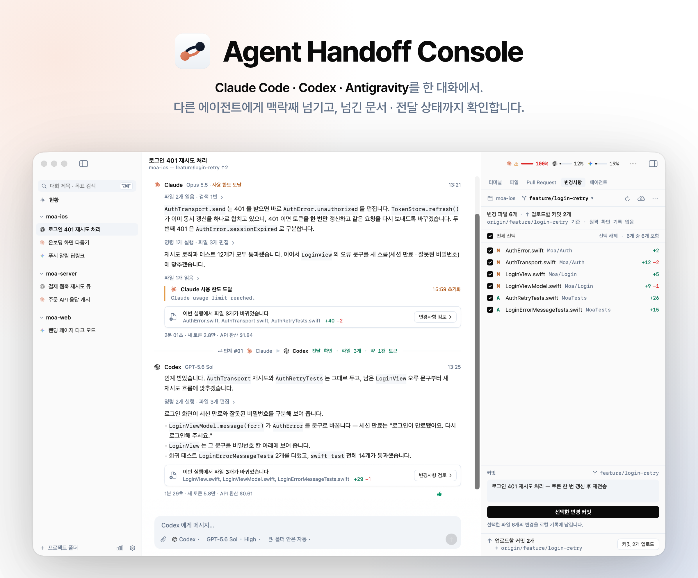
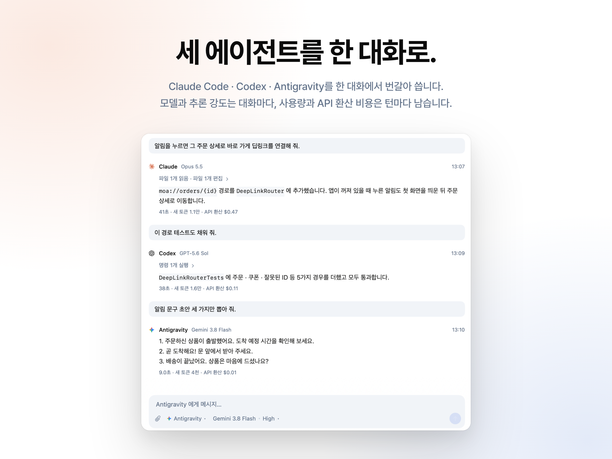
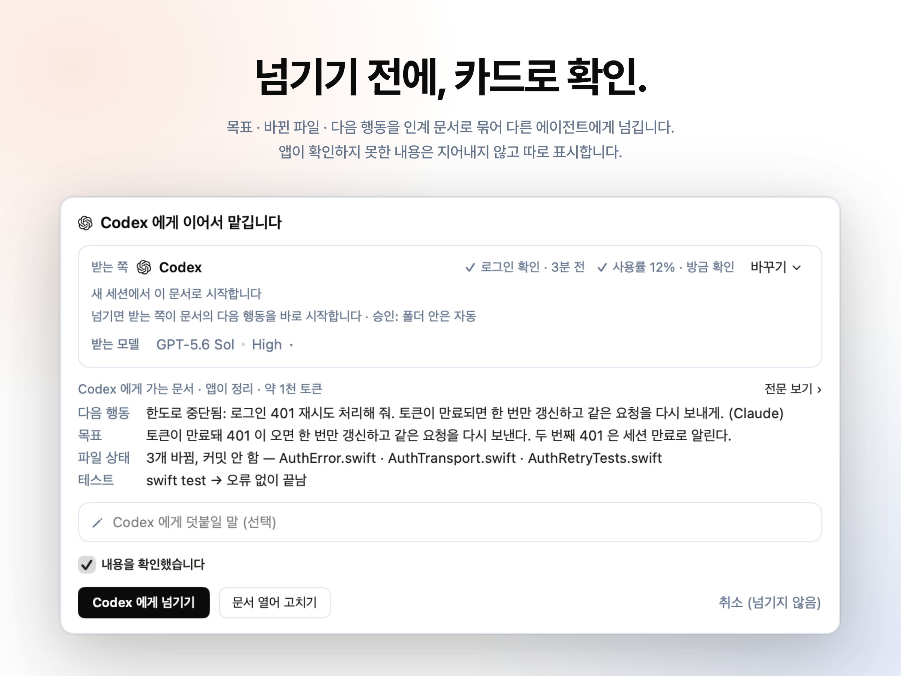
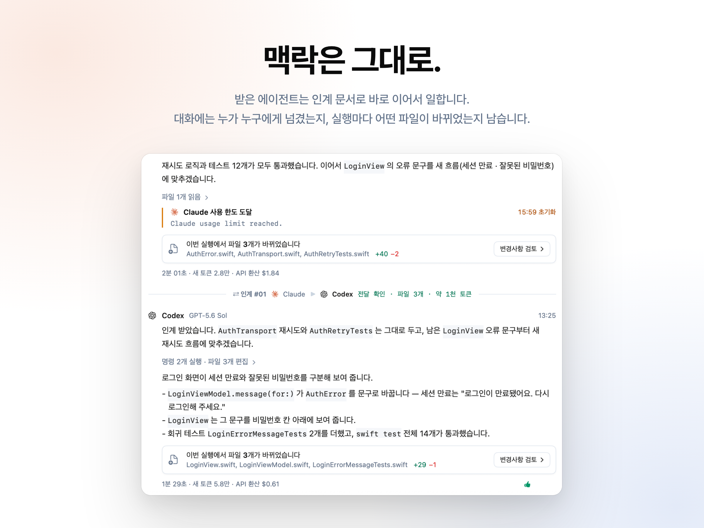
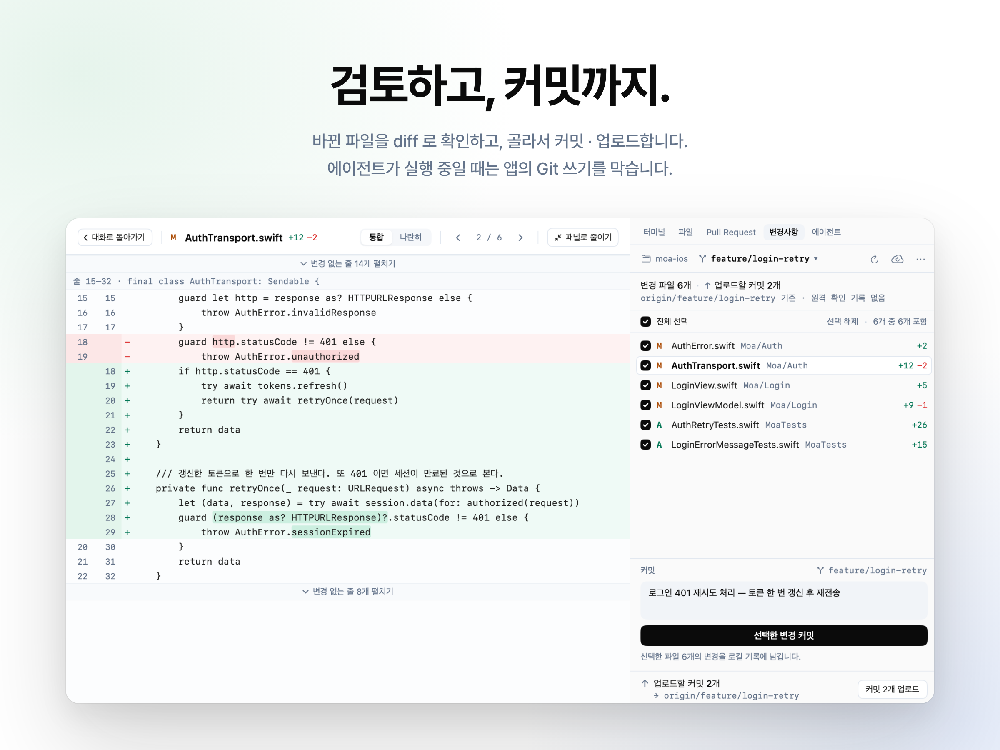

# Agent Handoff Console

[English](README.md) · **한국어**

<!-- 소개 이미지(docs/images/)는 실제 앱 화면이다. 화면이 바뀌면 bash scripts/readme-images/make.sh 로 다시 만든다. -->
<picture>
  <source media="(prefers-color-scheme: dark)" srcset="docs/images/hero-dark.png">
  
</picture>

Claude Code · Codex CLI · Antigravity(Gemini) 를 하나의 프로젝트 · 대화 화면에서 쓰고,
작업 맥락을 인계 문서로 묶어 다른 에이전트에게 넘기는 macOS 네이티브 앱.

에이전트를 바꿀 때마다 되풀이하던 설명과 작업 재탐색을 줄이는 것이 목적이다 — 한쪽이 사용 한도에 가까워졌을 때든,
다음 단계에 다른 에이전트가 더 맞을 때든. 넘기기 전에 인계 문서를 카드로 보여 주고, 넘긴 뒤에는 전달됐는지까지 기록한다.

- v0.1 의 화면은 **한국어**다. 영어 화면은 v0.2 에 넣을 계획이다 (영어 소개는 [README.md](README.md)).
- Anthropic · OpenAI · Google 과 관계없는 개인 프로젝트다. 에이전트는 사용자가 설치 · 로그인한 공식 CLI 를 그대로 띄운다.

## 한눈에 보기









---

## 설치

### 릴리스 받기

1. [Releases](https://github.com/jinuklee777/agent-handoff-console/releases) 에서 최신 릴리스의 zip 을 받고, 릴리스에 적힌 SHA-256 과 같은지 확인한다.

   ```bash
   shasum -a 256 ~/Downloads/AgentHandoffConsole-*.zip
   ```

2. 풀어서 나온 `AgentHandoffConsole.app` 을 `응용 프로그램` 폴더(또는 `~/Applications`)로 옮긴다.
3. 이 앱은 Apple Developer ID 로 서명 · 공증하지 않았다 (ad-hoc 서명). 그래서 처음 한 번은 macOS 가 막는다.
   - 앱을 열면 Apple 이 악성 코드를 확인할 수 없다는 창이 뜬다 — [완료] 를 누른다.
   - 시스템 설정 > 개인정보 보호 및 보안 > 보안 에서 AgentHandoffConsole 의 [그래도 열기] 를 누르고 암호(또는 Touch ID)로 확인한다.
   - macOS 15 부터는 Control-클릭 > 열기로 이 확인을 건너뛸 수 없다.
   - 받은 파일을 믿는다면 터미널에서 격리 표시를 지워도 된다 (macOS 가 앱이 "손상되었다" 고 할 때도 이 방법이다).

     ```bash
     xattr -dr com.apple.quarantine /Applications/AgentHandoffConsole.app
     ```

자동 업데이트는 없다. 새 버전은 같은 방법으로 받아 바꾼다.

### 소스에서 빌드

Xcode 26 이 필요하다 (macOS 26 SDK 의 API 를 쓴다 — 빌드한 앱은 macOS 15 이상에서 돈다).

```bash
git clone https://github.com/jinuklee777/agent-handoff-console.git
cd agent-handoff-console
xcodebuild -project AgentHandoffConsole.xcodeproj -scheme AgentHandoffConsole \
  -configuration Release -derivedDataPath build/DerivedData.noindex build
open build/DerivedData.noindex/Build/Products/Release/AgentHandoffConsole.app
```

- 처음 빌드할 때 Swift Package Manager 가 SwiftTerm 1.10.0 을 받는다 (외부 의존성은 이것 하나다).
- 빌드는 `-derivedDataPath build/DerivedData.noindex` 로 한다 — 기본 DerivedData 에 쌓인 사본은 Spotlight 에 같은 이름의 앱으로 겹쳐 뜬다 (`.noindex` 폴더는 색인하지 않는다).
- 직접 빌드한 앱에는 격리 표시가 붙지 않아 Gatekeeper 가 막지 않는다.
- `xcodebuild` 가 Command Line Tools 를 가리켜 실패하면 `sudo xcode-select -s /Applications/Xcode.app` 로 Xcode 를 고른다.

빌드부터 설치 · 다시 열기까지 한 번에 하려면:

```bash
./scripts/install-app.sh
```

`~/Applications/AgentHandoffConsole.app` 한 곳에 설치하고 다시 연다. Spotlight · 알림 · 번들 ID 로 열 때도 이 설치본이 열린다.

- 빌드가 실패하면 설치된 앱을 건드리지 않는다. 실행 중인 앱은 ⌘Q 와 같은 길로 끄므로, 실행 중인 에이전트가 있으면 앱이 먼저 확인을 묻는다.
- 같은 번들 ID 의 다른 사본(빌드 폴더 · Xcode DerivedData)은 LaunchServices 등록만 해제한다 — 파일은 지우지 않는다.
- 고친 뒤 다시 빌드에 Release 는 약 40초, `--debug` 는 몇 초 걸린다 (Debug 는 최적화하지 않고 "디버그" 메뉴가 붙는다). `--no-launch` 는 설치만 한다.
- 이 앱이 띄운 에이전트가 실행하면 앱을 끄지 않는다. 앱을 종료(⌘Q)할 때 새 빌드로 바꿔 다시 연다.
- 설치본의 빌드 번호는 커밋 수라, 빌드 폴더의 사본보다 설치본이 먼저 열린다.

Xcode 에서 열기 (저장소 폴더에서):

```bash
open AgentHandoffConsole.xcodeproj
```

### 처음 열면

프로젝트가 없으므로 가운데에 시작 점검표가 뜬다: ① 에이전트(Claude Code · Codex 의 설치 · 로그인, Antigravity 는 선택)
② 알림(권한 · Dock 배지) ③ 작업할 폴더(Command Line Tools 가 없으면 한 줄 안내). ①②는 안내일 뿐 ③을 막지 않고, 로그인을 확인하지 못한
CLI 는 황색 안내와 함께 통과로 센다 (Claude 는 API 키 · Bedrock · Vertex 를 쓰는 환경이면 "로그인 안 됨" 대신 확인하지 못함으로 본다).
찾았지만 실행되지 않는 CLI 는 설치 안내가 아니라 "실행할 수 없음" 과 CLI 가 남긴 말을 보이고 경로를 지정하게 한다.
앱은 설치 · 로그인을 대신 실행하지 않는다 — 공식 안내를 열고 명령(`claude auth login`, `codex login` — 추가 Codex 계정은 그 계정 폴더
`CODEX_HOME=…` 을 붙인 것 — 등)을 복사만 한다. 터미널에서 하고 돌아오면 앱이 다시 확인한다("다시 확인" 은 로그인 셸의 환경부터 다시
읽는다 — 아래 "셸 환경"). 쓸 수 있는 에이전트가 아직 없고 "로그인 필요" 가 있으면 점검표가 보이는 동안 5초마다 로그인만 다시 본다.
폴더를 고르면(파일 > 프로젝트 폴더 열기… ⌘O) 첫 대화가 준비된 에이전트로 열린다 (그 선택을 바꿀 수 있는 확인이 도는 중이면 최대 8초
기다린다). 같은 폴더(심볼릭 링크 포함)를 다시 고르면 새로 만들지 않고 그 프로젝트를 연다. 첫 프로젝트를 열기 전에는 Claude 의 모델 목록 ·
사용 한도 조회(`claude -p` 세션)를 미룬다. 프로젝트가 있어도 도움말 > 시작 점검… 으로 같은 화면을 시트로 볼 수 있다 (도움말 메뉴에는
이 앱 소개 ⌘? · 키보드 단축키도 있다).

## 환경

| 항목 | 값 |
|---|---|
| 개발한 Mac | macOS 26.5.1 (25F80), Apple Silicon |
| Xcode | 26.6 (17F113), Swift 6.3.3. 빌드에는 **Xcode 26 이상**이 필요하다 (macOS 26 SDK 의 API — `ToolbarSpacer` 등 — 를 `#available` 로 감싸 쓴다) |
| 배포 대상 | **macOS 15.0** — 쓰는 API(`MenuBarExtra` · `@Observable` · `.inspector` · 스크롤 관찰 `onScrollGeometryChange` · `onScrollPhaseChange`) 가운데 가장 늦은 것이 macOS 15 다 |
| Swift 언어 모드 | 5 (컴파일러는 6.3.3). 액터·락 경계를 직접 관리하며 엄격 동시성 검사는 켜지 않았다 |
| 서명 | ad-hoc (`CODE_SIGN_IDENTITY = "-"`). Developer ID 서명 · 공증은 아직 없다 — 받은 zip 은 처음 한 번 Gatekeeper 를 넘겨야 한다 (위 "설치") |
| 샌드박스 | **없음**. Mac App Store 배포 대상이 아니며, 임의 경로의 프로젝트에서 CLI 를 실행해야 한다 |
| 실측한 CLI | Claude Code **2.1.266** · 2.1.270 · 2.1.292, Codex CLI **0.153.4** · 0.154.0 · 0.160.1, Antigravity CLI(`agy`) **1.2.1** · 1.2.2 · 1.3.2 — 어느 버전에서 무엇을 쟀는지는 [CLI 프로토콜](docs/CLI프로토콜.md). 실제 CLI 시험(스트리밍 · 재개 · 승인 · 중단 · Claude → Codex → Claude 인계 · Antigravity)은 Claude Code 2.1.295 · Codex CLI 0.162.0 · agy 1.3.3 에서도 통과했다 (2026-10-10) |

Electron / React / Node 런타임은 사용하지 않는다.
외부 의존성은 **SwiftTerm 1.10.0** 하나다 (인스펙터의 앱 내장 터미널).
1.15 이상은 Metal 셰이더를 컴파일해 `xcodebuild -downloadComponent MetalToolchain` 이 필요해서 고정해 두었다.

## 구조

코드의 책임 · 데이터 흐름 · 작업별 시작 파일은 [코드 구조 지도](docs/코드구조.md)에 있다 (기여자와 AI 에이전트의 입구 —
Codex 는 [AGENTS.md](AGENTS.md), Claude Code 는 [CLAUDE.md](CLAUDE.md) 를 거쳐 같은 지도를 읽는다). CLI 응답의 실측 근거는
[CLI 프로토콜](docs/CLI프로토콜.md)에 있다. 개발 문서 · 코드 주석 · 커밋 메시지는 한국어다.

```
AgentHandoffConsole/
  App/            전역 상태(AppModel)와 사용자 동작, 화면이 쓰는 판정(순수 코드)
  Core/           도메인 모델 · 화면 공용 형식
  Agents/         CLI 어댑터(Claude · Codex · Antigravity), 자식 프로세스, 셸 환경, 모델 목록
  Runtime/        실행 하나(RunSession) · 실행 묶음(RunCoordinator), 한도, 알림, Codex 계정
  Handoff/        인계 문서(규칙 초안) · 인계 시점의 git 스냅샷
  Assist/         Gemini 보조 요약 · 비밀값 가리기 · 자동 인계 판정 · 이어 가기 판정 · 대화 제목
  Orchestration/  자동 작업 (실험 기능)
  Storage/        SQLite · 마이그레이션 · Store
  Workspace/      git 읽기 · 쓰기, diff, 독립 작업 폴더, gh
  Import/         Claude Code · Codex 기록 가져오기
  Pricing/        가격표 · API 환산 비용
  UI/             SwiftUI 화면 (대화 · 인스펙터 · 설정 · 디자인 토큰 …)
scripts/          검증 하네스(inttest) · 설치 · 화면 확인 · README 이미지 · CLI 실측 도구
docs/             코드 구조 지도 · CLI 프로토콜 · 소개 이미지
```

UI · 실행 상태 관리 · CLI 어댑터 · 저장 계층이 분리되어 있다.
스트림 파싱, 파일 처리, DB 작업은 메인 스레드를 막지 않는다.
CLI 이벤트는 `AgentEvent` 라는 중간 표현으로 바뀌어, CLI 프로토콜 변경이 어댑터 안에서 흡수된다.

## 데이터

앱 데이터는 다음 위치에 보관한다. 앱 번들이나 소스 폴더에 사용자 기록을 저장하지 않는다.

```
~/Library/Application Support/AgentHandoffConsole/handoff.sqlite3
```

입력창에 붙인 이미지는 같은 폴더의 `attachments/` 에, 독립 작업 폴더(아래)는 기본으로 `~/.agent-handoff-console/worktrees/` 에 둔다.
이미지 파일은 그것을 쓰는 마지막 대화를 지우거나 보내기 전에 입력창에서 빼면 지운다 (다른 대화 · 대기열 · 입력창이 쓰는 파일은 남고, `attachments/` 밖의 파일은 건드리지 않는다).

테이블: `project`, `thread`, `composer_draft`, `agent_session`, `run`, `event`, `handoff`,
`usage_record`, `rating`, `price_entry`, `app_setting`, `cli_verification`, `codex_account`, `assist_result`, `model_option`,
자동 작업의 `orchestration_*` · `verification_result` · `routing_decision`.
`PRAGMA user_version` 기반 마이그레이션이 있다 (현재 v10 — 대화마다 Codex 세션 하나 · `agent_session.record_home`).
v4 에서는 대화별 메시지 입력 초안(`composer_draft`)을 저장해
화면이나 대화를 바꿔도 작성 중인 내용이 섞이거나 사라지지 않게 한다.

## 무엇을 실행하고, 무엇이 이 Mac 밖으로 나가나

- **앱에는 서버 · 계정 · 사용 통계가 없다.** 앱 자체는 네트워크 요청을 하지 않는다. 네트워크는 앱이 띄운 CLI(`claude` · `codex` ·
  `agy` · `git` · `gh`)가 각자의 설정과 약관대로 쓴다.
- **에이전트에게 보낸 메시지**는 그 CLI 가 자기 회사 서버로 보낸다. 대화 말고도 앱이 확인을 위해 CLI 를 띄우는 때가 있다:
  - 앱을 열 때 · 시작 점검: 실행 파일 확인(`--version`), Claude 로그인(`claude auth status --json`), Codex 계정 폴더의 파일 읽기.
  - 사용 한도: Codex 는 `codex app-server` 에 묻는다 (계정의 이메일 · 플랜을 묻는 `account/read` 포함). Claude 는 `claude -p /usage` 를
    띄운다 — 사용자의 훅 · MCP 까지 도는 Claude Code 세션이다. 앱을 열 때 · Claude 실행이 끝날 때(1분에 한 번까지) · 자동 인계 직전 · 사람이
    한도를 새로 고칠 때 띄운다. 설정 > 에이전트 > Claude Code 의 "앱을 열 때 사용 한도 확인" 을 끄면 앱을 열 때(첫 프로젝트를 열 때 · Claude
    로그인이 막 확인됐을 때 포함)의 확인과 이어 가기 제안 · 한도 도달 줄이 스스로 하는 새로 읽기만 하지 않는다 — Claude 실행이 끝난 뒤와
    자동 인계 직전의 확인은 그대로 한다.
    Antigravity 는 허용한 프로젝트가 있을 때만 `agy -p /usage`(모델을 부르지 않는 명령)로 읽는다.
  - 모델 목록: Codex 는 열 때마다 `model/list`, Claude 는 받아 둔 목록이 하루 지났거나 CLI 버전이 바뀌었을 때만 `claude -p /model`.
    처음 설치해 프로젝트가 없으면 Claude 의 두 조회는 첫 프로젝트를 열 때까지 미룬다. `agy models` 는 Antigravity 를 허용한 프로젝트가
    있거나 인계 문서를 Gemini 로 다듬기로 했을 때만 부른다.
  - 입력창의 "/" 목록: CLI 에게 명령 · 스킬 목록을 묻는다 (Claude 는 모델을 부르지 않는 `initialize` 만, Codex 는 `skills/list`).
  - 대화 제목: 대화의 첫 실행이 정상으로 끝나면 같은 회사의 작은 모델(Claude 는 `claude -p --model haiku`, Codex 는 `codex exec`)에게
    첫 메시지 · 첫 답의 앞부분(비밀값은 최선 노력으로 가림)을 보내 짧은 제목을 받는다. 이 호출은 CLI 의 세션 기록에 남지 않는다.
    설정 > 일반의 "대화 제목 자동 요약" 으로 끈다.
- **인계 문서**는 받는 에이전트의 CLI 를 거쳐 그 회사로 간다 — 바꾼 파일 · 실행한 명령 · 대화 발췌가 들어 있다 (비밀값은 최선 노력으로
  가린다). 자동 인계를 켜면 사람이 확인하지 않아도 간다.
- **Gemini 로 다듬기**(기본 꺼짐)를 고르면 인계 재료(대화 · 도구 출력 · 제한된 git diff, 비밀값 가림)를 `agy` 로 Google 에 보낸다.
  프로젝트마다 끌 수 있다.
- **git · gh**: 앱이 실행하는 `git` 은 변경사항 탭에서 원격 확인 · 받기 · 업로드를 할 때만 원격과 주고받는다. `gh` 는 변경사항 탭이나
  Pull Request 탭을 열 때 지금 브랜치의 PR 을 GitHub 에 묻는다 (`gh pr view` · `gh pr list` — gh 가 설치돼 있을 때 프로젝트 · 브랜치마다
  한 번, 변경사항 탭은 원격이 있는 저장소만). 주기적으로 묻지 않고, 다시 묻기는 변경사항 탭 ··· 메뉴의 "PR 다시 조회" · Pull Request 탭의 새로고침이다.
- **셸 환경**: 앱은 로그인 셸에 한 번 물어 PATH 와 CLI 에 필요한 변수만 자식 프로세스에 넘긴다 (값은 메모리에만 — 아래 "셸 환경").
  셸의 `ANTHROPIC_API_KEY` · `ANTHROPIC_AUTH_TOKEN` · `OPENAI_API_KEY` · `CODEX_API_KEY` · `CODEX_ACCESS_TOKEN` · `GEMINI_API_KEY` · `GOOGLE_API_KEY` · `GOOGLE_CLOUD_API_KEY` · `CLAUDE_CODE_OAUTH_TOKEN` 는 설정 > 에이전트의 "셸의 API 키를 에이전트에게 넘기기" 를 켠
  때만 넘긴다 — 넘기면 `claude -p` 가 구독 대신 그 키로 청구된다.
- **Claude 세션 기록**: 대화를 독립 작업 폴더로 옮기거나 정리할 때 그 대화의 Claude 세션 파일을 `~/.claude/projects/`(또는
  `$CLAUDE_CONFIG_DIR`) 안에서 새 폴더의 칸으로 복사한다 — `claude --resume` 은 그 세션이 속한 폴더의 칸에서만 찾는다.
- **Codex 계정 폴더**: 대화의 Codex 세션을 다른 계정으로 이어 갈 때, 그 실행 하나만의 `CODEX_HOME` 을 사용자 임시 폴더에 심볼릭 링크로
  꾸린다 (실행 계정의 `auth.json` · `config.toml` · 스킬 …, 세션이 있는 계정 폴더의 기록 항목). 아무것도 복사하지 않아 토큰 갱신은 그 계정의
  `auth.json` 에 써지고, 실행이 끝나면 그 폴더를 지운다. 세션이 있는 계정 폴더에는 빠진 기록 항목의 빈 폴더 · 빈 파일만 만든다.
- **Codex 의 클라이언트 이름**: 앱은 `codex app-server` 에 `AgentHandoffConsole` 이라는 이름(`clientInfo`)으로 자신을 알린다. 그 이름을
  Codex 가 어떻게 쓰는지는 Codex 의 몫이다.
- **Claude API 키**(넣었을 때)는 키체인에만 두고, API 크레딧으로 실행하는 대화의 `claude` 프로세스에만 넘긴다. 대화 기록 · 인계 문서 · 로그에는 남기지 않는다.
- 샌드박스가 없는 앱이라 CLI 가 띄운 macOS 권한 요청(폴더 · 사진 보관함 접근 등)이 이 앱 이름으로 뜬다 (아래 "알려진 제한").

## Claude Code · Codex 기록 가져오기

파일 메뉴 > "Claude Code · Codex 기록 가져오기…" (설정 > 일반에도 있다). 이 Mac 의 `~/.claude/projects/*/*.jsonl` 과
`~/.codex/sessions/**/*.jsonl` 을 읽어 작업 폴더별로 보여 주고, 체크한 폴더를 프로젝트로, 그 안의 세션을 대화로 옮긴다.

- 자동 선별: 존재하는 폴더 중 git 저장소이거나 세션이 2개 이상인 것. 임시 폴더(`/var/folders`, `/tmp`), Codex 앱 스크래치
  (`~/Documents/Codex/<날짜>/…`), 루트 · 홈, worktree 폴더(`.claude/worktrees`)는 빠진다. "선별에서 빠진 폴더 보기" 로 전부 볼 수 있다.
- 옮긴 대화에는 기록 전문이 들어간다 — 사용자 메시지, 응답, 도구 요청 · 결과(4000자까지), 명령 실행(출력 · 종료 코드), 파일 변경.
  thinking · 슬래시 명령 기록 · 앱이 끼워 넣은 맥락 메시지는 옮기지 않는다. 사용량 · 비용은 옮기지 않는다
  (턴 머리글에 모델만 보인다). 첫 행은 어느 파일에서 왔는지 적은 안내다.
- 하위 에이전트: Claude 의 Agent 하위 기록(`<세션>/subagents/agent-*.jsonl`)은 띄운 Agent 호출 아래에 실행 중 앱과 같은 모양(카드 ·
  에이전트 탭)으로 붙인다. 워크플로 안의 에이전트는 옮기지 않는다. 백그라운드 작업이 끝나 CLI 가 연 후속 턴은 사람의 메시지로 만들지 않고
  앞 턴에 붙인다. Codex 의 하위 에이전트 · 검토 스레드 기록은 목록에서 뺀다 (메인 기록 안의 하위 흔적은 아직 옮기지 않는다).
- 세션 ID 를 `AgentSession.cliSessionID` 에 두므로 **다음 메시지는 그 CLI 세션을 이어간다** (Claude `--resume`, Codex `thread/resume`).
  Codex 세션은 기본 계정(`~/.codex`)의 것으로 등록한다 — 다른 계정 폴더(`CODEX_HOME`)의 기록은 읽지 않는다.
- 같은 CLI 세션 ID 가 이미 있으면 건너뛴다. 여러 번 실행해도 중복되지 않는다.
- 목록 위에 [모두 선택] · [추천만] · [모두 해제] 가 있다. 세션 파일은 통째로 읽지 않고 조금씩 읽어 요약에 쓸 줄만 고르며, 훑는 동안
  "세션 파일 n / N" 을 보이고 시트를 닫으면 훑기도 멈춘다. 가져오는 중 [멈추기] 를 누르면 지금 세션을 마친 뒤 멈춘다 — 그때까지 가져온
  것은 남고, 반쯤 쓴 세션 · 빈 프로젝트는 남지 않는다.

## 동작 원칙

**실행 모델** — 턴 하나당 CLI 프로세스 하나를 띄우고 턴이 끝나면 종료한다.
세션은 Claude `--session-id`/`--resume`, Codex `thread/start`/`thread/resume` 로 이어진다.
덕분에 인계 직전에 "이전 에이전트가 파일을 계속 고칠 가능성"을 프로세스 종료로 확인할 수 있다.
메인 턴이 끝나도 에이전트가 띄운 **하위 에이전트 · 워크플로(ultracode) · 백그라운드 셸**이 남아 있으면 프로세스를 끄지 않고
**같은 실행으로 기다린다** — 머리줄에 "백그라운드 작업 N개 기다리는 중"(기다린 시간은 대화 끝의 실행 중 상태 줄), 그동안 그 대화 보내기 · 그 폴더의 git 쓰기 · 인계는 막힌다.
Claude 는 작업이 끝나면 CLI 가 스스로 연 후속 턴의 답까지 받고, Codex 는 끝난 하위의 답을 대화 기록(`thread/inject_items`)에 넣어
다음 턴이 알게 한 뒤 끝낸다. 상한은 없다 — ⌘. 는 남은 작업까지 모두 멈춘다 (실행 중 빈 입력창의 esc 두 번 · 변경사항 탭의 [백그라운드 작업 멈추기] 도 같은 길). 하위 작업은 대화에서 띄운 자리의 카드로,
흐름 · 최종 답은 인스펙터 **에이전트** 탭(⌘⌥5)에서 본다 (Claude 는 작업 하나만 멈출 수도 있다). 사람이 지켜보지 않는 자동 작업의
계획 · 검토 턴은 기다리지 않는다.
**한 대화에는 실행 하나, 다른 대화의 실행은 함께 돈다** (같은 폴더여도). 아래 "분할 화면" 참고.

**셸 환경** — Finder · Dock 으로 연 앱은 셸 설정(`~/.zshrc` 등)의 PATH · API 키 · 프록시를 물려받지 않는다. 그래서 앱이 대화형 로그인 셸
(`$SHELL -ilc`, 안 되면 로그인 셸)에게 한 번 물어(셸마다 5초 제한, 셸 설정은 고치지 않는다) PATH 와 CLI 에 필요한 변수만 자식 프로세스에 넘긴다 —
`ANTHROPIC_*` · `CLAUDE_CODE_*` · `OPENAI_*` · `CODEX_*`(`CODEX_HOME` 은 빼고 — 계정 폴더는 앱이 넘긴다) · `AWS_*` · `GOOGLE_*` · `GEMINI_*` ·
프록시 · 사내 인증서 등. 값은 메모리에만 둔다. 셸 설정을 읽지 못했으면 시작 점검이 그 사실을 알린다. CLI 실행 파일은 설정에서 지정한 경로 →
셸의 PATH → 버전 관리자(nvm · fnm · mise · asdf · nodenv · pnpm · yarn) 폴더 · 일반 설치 위치 차례로 찾고, 찾아도 `--version` 이 돌지 않으면 쓸 수 없는 것으로 본다.

**Codex 계정** — 계정 하나는 계정 폴더(`CODEX_HOME`) 하나다. 실행할 때 그 값을 **자식 프로세스에만** 넘긴다.
앱은 `~/.codex` 를 포함한 어떤 계정 폴더의 기존 파일도 옮기거나 고쳐 쓰지 않으며, `auth.json` 은 읽기만 한다 (다른 계정으로 같은 세션을
이어 갈 때 기록 폴더에 빠진 기록 항목의 빈 폴더 · 빈 파일만 만든다 — 아래 "Codex 계정 전환").
로그인은 사용자가 터미널에서 직접 한다. 자세한 내용은 아래 "Codex 계정 전환" 참고.

**Antigravity(Gemini) 작업 에이전트** — 가벼운 작업을 `agy` 로 대신 시킬 수 있다.
이 CLI 는 헤드리스에서 권한을 물을 방법이 없어(공식 이슈 #548) **승인 없이 파일을 고치고 명령을 실행**한다.
그래서 **프로젝트별로 켜야** 쓸 수 있고(기본 꺼짐), 실행된 도구·명령은 대화에 그대로 남는다.
샌드박스를 켜면 셸 명령이 파일을 쓰지 못한다. Claude·Codex 의 승인 정책은 그대로다.
남은 한도는 `agy -p /usage`(모델을 부르지 않는 명령)로 읽어 한도 칩 · 팝오버 · 메뉴바 · 인계 카드에 보인다 — Antigravity 를 허용한 프로젝트가 있을 때만
읽고, 한도는 모델 묶음(Gemini · Claude/GPT)마다 따로다. 다만 v0.1 에서는 **자동 인계 · 이어 가기 제안의 대상에서는 빠진다**(수동 인계 · 칩의 이어 맡기기는 가능).

**터미널** — 인스펙터 터미널 탭의 셸 하위 탭(이름은 `$SHELL` — 보통 `zsh`)에서 **앱 안에서 도는 사용자 셸**을 쓴다 (SwiftTerm · PTY).
세션은 대화가 일하는 폴더(프로젝트 폴더 · 독립 작업 폴더)마다 하나이고 탭을 옮겨도 살아 있다. 앱은 이 셸의 입력·출력을 **저장하지 않고**
에이전트에게도 보내지 않는다. 같은 탭의 "에이전트 실행" 하위 탭은 에이전트가 실행한 명령과 앱이 사람 대신 실행한 git · 독립 작업 폴더 명령("앱" 표시)을
읽기 전용으로 보여준다 — 프롬프트의 경로는 그 명령이 돈 폴더다. 앱을 끝낼 때 셸에서 명령이 돌고 있으면 종료 확인 창이 그 수를 적고, 앱이 띄운 셸은
종료가 확정된 뒤에 정리한다 (취소하면 셸과 그 안의 개발 서버가 그대로 산다).

**Git 쓰기** — 변경사항 탭에서 커밋에 포함(스테이지) · 커밋 · 브랜치 만들기/전환 · 원격 상태 확인(fetch) · 원격 변경 받기(pull) · 업로드(push) 를 한다
(화면은 이 이름을 쓰고, git 명령 이름은 도움말 · 기록에만 쓴다). 저장소가 아닌 폴더에서는 [이 폴더에서 git 시작하기…] 가 확인을 받은 뒤 `git init` 만 한다
(첫 커밋은 사람이 체크한 파일로). git 이 없는 Mac 에서는 Command Line Tools 설치 명령과 [시작 점검 열기] 를 보인다.
파일 체크박스(커밋에 포함)가 곧 스테이지다 (켜면 `git add`, 끄면 `git restore --staged`, 양쪽에 걸친 파일은 "일부만 포함됨"). 체크박스와 diff 열기는
따로 누르는 단추라 키보드 · VoiceOver 로도 diff 를 연다. 체크는 대화에 남기지 않는다 — 무엇이 기록됐는지는 커밋이 남긴다. 경로가 200개를 넘으면
인수 대신 stdin(`--pathspec-from-file=-`)으로 넘긴다.
**그 폴더에서** 에이전트가 실행 중이거나 시작하는 중이거나 독립 작업 폴더 명령(합치기 · 준비 명령 …)이 돌 때, 그리고 종료가 확인되지 않은 프로세스가
있을 때 **막는다**(파일 경합 — 다른 폴더의 실행은 막지 않는다). 앱의 git 쓰기는 한 번에 하나라 다른 프로젝트에서 업로드 · 받기가 도는 동안에도 기다린다.
막은 까닭은 탭 안에 적는다 — 종료 미확인 프로세스는 그 목록과 [확인함], 메인 턴을 마치고 백그라운드 작업만 남은 실행은 [백그라운드 작업 멈추기].
목록은 그동안에도 볼 수 있고, 에이전트가 파일을 바꾸면 실행 중에도 곧(1.5초 모아 한 번) 다시 읽는다 — 주기적으로 읽지는 않는다 (탭이 나타날 때
오래됐으면, 머리의 ↻ 로도 다시 읽는다). 성공 여부는 git 의 종료 코드로만 판단한다 (훅이 실패하면 커밋 실패로 보이고,
메시지와 선택은 그대로 남는다). 기록에는 git 이 준 종료 코드만 남긴다 (시간 초과 · 실행 실패면 적지 않는다).
체크박스의 경로는 `git status` 가 준 저장소 루트 기준이라 stage · unstage 는 저장소 루트에서, 글자 그대로
(`GIT_LITERAL_PATHSPECS=1`, `a[1].txt` 가 `a1.txt` 를 끌어오지 않게) 실행한다.
pull · push 는 확인을 받고(확인 창에 받거나 올릴 커밋 목록과 대상), 실행한 명령과 출력은 대화에 남아 인계 문서까지 이어진다.
`reset --hard` · `clean` · `push --force` · 브랜치 삭제처럼 되돌리기 어려운 명령은 앱이 하지 않는다.
커밋 메시지는 인수가 아니라 stdin 으로 넘기고, 사용자의 git 설정(이름 · 서명 · 훅)을 그대로 따른다.
원격과 기록이 갈라지면(앞섬 · 뒤처짐 둘 다) 업로드 · 받기를 두지 않고 "터미널에서 합치기" 만 둔다 — 앱은 원격 기록과 합치지 않는다.
병합 중(`MERGE_HEAD`)이면 `MERGE_MSG` 를 주석 줄 없이 커밋 초안으로 채우고(초안이 비어 있을 때만), 충돌 파일은
체크할 수 없다. 파일 안의 충돌 표시를 정리하고 저장한 뒤 [해결됨으로 표시…] 를 누르면 파일마다 충돌 표시(`<<<<<<<` · `>>>>>>>`)가 남았는지 읽어
보이고, 정리된 파일만 `git add` 로 해결됨을 표시한다 (읽지 못한 이진 · 큰 파일은 사람이 골라 표시할 수 있다). 그 뒤의 커밋이 병합 커밋을 완성한다
(git 의 정상 동작).
병합 · rebase 중에는 이미 포함된 파일을 커밋에서 빼지 않는다 (빼고 커밋하면 합쳐진 변경이 병합 커밋에서 빠진다).
rebase 가 멈춰 있으면(`rebase-merge` · `rebase-apply`) 커밋 · 업로드를 두지 않고, 충돌은 [해결됨으로 표시…] 로 알린 뒤 터미널의 `git rebase --continue` · `--abort` 로 이어 가라고 안내한다.
받기 확인 창의 커밋 목록 · 개수는 마지막 확인(fetch) 기준이다 — `git pull` 은 받기 전에 원격을 다시 확인해 그 뒤 올라온 커밋도 받는다.
push · pull · fetch · 커밋이 실패하면 출력을 분류해 탭 안에 이유와 다음 행동을 적는다 (기록 분기 · 로그인 필요 ·
겹치는 로컬 변경 · 커밋할 것 없음 · 신원 미설정 · 다른 worktree 가 쓰는 브랜치, `Workspace/GitFailure.swift`). 분류되지 않으면 git 의 한 줄을 그대로 보여준다.
원격 명령의 실패 안내는 명령 직후 다시 읽은 상태(브랜치 · HEAD · 앞섬/뒤처짐 · 마지막 fetch · 병합/rebase)가 그대로일 때만
남는다 — 터미널에서 로그인하고 올렸거나 fetch 로 기록 분기가 드러났으면 지금 상태 화면으로 돌아간다. 탭 안에 보여줄 자리가
없으면(병합 · rebase 중, 상태를 읽지 못함) 배너로 알린다. "GitHub" 는 git 이 말을 건 주소의 host 가 github.com 일 때만 쓴다
(출력의 주소 → 올리는 원격(`pushRemote` · `remote.pushDefault`, pushurl) → 추적 브랜치의 원격 순).
업로드 · 브랜치 업로드 · 받기 · 원격 확인이 도는 동안에는 바닥에 무엇을 어디로 하는지("커밋 3개를 올리는 중… → origin/x")와
그동안 다른 git 동작을 막아 둔다는 사실을 적고(다른 프로젝트의 변경사항 탭에도 그 까닭이 보인다), 성공하면 몇 초(4초) 동안 "업로드 완료 · origin/x 이 최신입니다" 를 보인 뒤
평상 상태로 돌아간다 — 이 타이머는 화면만 다시 그리고 git 을 다시 부르지 않는다. "PR #n에 반영" 은 캐시에 열린 PR 이 있고
그 head 가 지금 브랜치일 때만 쓰고, 성공 문구의 "PR #n에 반영됐습니다" 는 그 PR 을 10분 안에 조회했을 때만 쓴다 (오래된
캐시면 그 사이 병합 · 닫힘을 모르므로 올린 커밋 수만 적는다). 도는 동안 커밋 버튼도 꺼진 모양이 된다. 확인 창이 열린 동안 프로젝트나 브랜치가 바뀌면 창을 닫고 커밋 칸 위에 한 번 알린다
("브랜치가 바뀌었습니다 · main → feature/login · 이제 feature/login 에 커밋됩니다", 확인으로 닫음). 커밋 메시지 초안은 폴더마다 따로 둔다
(같은 프로젝트의 독립 작업 폴더도 따로).

**브랜치 메뉴** — 변경사항 탭 머리줄의 브랜치 ▾ (또는 `⌘⇧N` 으로 새 이름 입력 상태). 현재 브랜치 · 최근 브랜치(마지막 커밋 순) ·
원격에만 있는 브랜치를 보여주고, 찾기 칸은 대소문자 없이 부분 일치로 거른다. 찾는 이름과 정확히 같은 브랜치가 없으면 맨 위가
"새 브랜치 <이름> 만들기"(`git switch -c`, 이름은 명령을 만들 때와 같은 검사). 전환은 `git switch <이름>` 이다 — 원격에만 있는
브랜치도 원격 접두어를 뗀 이름으로 전환하며, 그 이름이 원격 하나에만 있으면 git 이 추적 브랜치를 만든다(git 기본 동작, 새 명령
아님). 원격이 여럿이면 행마다 원격 이름을 적고, 같은 이름이 여러 원격에 있으면 그 행들은 잠근다 — git 은 보통 거부하지만
`checkout.defaultRemote` 가 있으면 누른 행과 다른 원격을 따라가므로, 터미널의 `git switch --track <원격>/<이름>` 을 안내한다.
있는 브랜치와 대소문자만 다른 새 이름(`Main`)은 막는다 (macOS 기본 파일 시스템에서는 같은 브랜치 파일이 된다).
변경 파일은 전환한 브랜치로 함께 옮겨지고, 겹치는 파일이 있으면 git 이 전환하지 않아 그 파일 이름을 알린다. 병합 · rebase 중이면
git 이 전환 · 만들기를 거부하고, 충돌 파일만 남아 있으면(`stash pop` 충돌 등) 다른 브랜치로의 전환만 거부하므로 그만큼만
미리 잠그고 이유를 적는다 (그때 새 브랜치 만들기는 git 이 허용한다). 목록은 섹션마다 50개(찾기 결과는 100개)까지 그리고
나머지는 개수만 적는다. 앱은 브랜치마다 어느 에이전트가 작업했는지 기록하지 않아, 에이전트 표시는 현재 브랜치
행(이 대화의 에이전트)에만 붙인다. 다른 git worktree(독립 작업 폴더의 `ahc/…` 등)가 쓰는 브랜치 행은 git 이 전환하지 않으므로 그 폴더와 함께
잠그고, 독립 작업 폴더의 대화에서는 전환 · 만들기를 모두 막는다 (그 대화의 브랜치에서 일하고 프로젝트 폴더로 합친다). 다른 브랜치 합치기 · 되돌리기 ·
강제 업로드 · 브랜치 삭제는 앱이 하지 않는다 (독립 작업 폴더의 합치기 · 정리만 앱이 한다 — 아래).

**독립 작업 폴더** — 대화마다 따로 둘 수 있는 git worktree 다. 사이드바의 프로젝트 메뉴 "독립 작업 폴더에서 새 대화"(저장소가 아니거나 첫 커밋이
없으면 까닭과 함께 꺼진다)나 대화 행의 "독립 작업 폴더로 옮기기…"(따라오지 않는 것 — 커밋하지 않은 변경 · git 이 무시하는 파일 — 을 확인 창이 먼저 적는다)로
만든다. 위치는 `~/.agent-handoff-console/worktrees/<저장소>/<대화 8자>`(설정 > 고급에서 바꾼다), 브랜치는 `ahc/<대화 8자>` 이고, 그 대화의 에이전트 ·
변경사항 · 파일 · 터미널이 그 폴더를 본다. 프로젝트 설정에 준비 명령(`npm install` 등)이 있으면 만든 뒤 그 폴더에서 돌린다 (도는 동안 그 대화 · 그 폴더만 막는다).
변경사항 탭 맨 위 칸에서 "<프로젝트 폴더의 브랜치> 에 합치기"(커밋하지 않은 변경이 있으면 메시지를 받아 커밋한 뒤) · "<브랜치> 에 맞추기"(프로젝트 폴더
브랜치의 새 커밋을 이 폴더로 합친다 — git pull 의 받기와 다른 일) · "정리…" 를 한다. 합치기는 프로젝트 폴더가 병합 · cherry-pick · revert · rebase 중이거나
합치면 바뀔 파일에 거기 커밋하지 않은 변경이 있으면 **아무것도 하지 않고** 멈추고, 실패해도 사람이 하던 병합은 되돌리지 않는다(`merge --abort` 는 이 합치기가
만든 병합 상태에만). 이 대화의 브랜치는 보통 원격에 올리지 않으므로 브랜치 업로드를 주 단추로 권하지 않는다. 대화를 지우면 독립 작업 폴더도 지운다
(합치지 않은 브랜치는 남긴다).

**실행별 변경 파일** — 실행 시작 직전(에이전트 프로세스를 띄우기 전)과 끝난 직후에 작업 폴더를 찍어(`git status` 의 경로 ·
대표 코드 · 마지막 커밋 대비 줄 수 + 파일 크기 · 수정 시각, 읽기 전용) 차이를 그 실행의 안내 이벤트 하나로 남긴다 (스키마 변경 없음,
`Workspace/RunChanges.swift`). 대화의 턴 바닥글 위에 "이번 실행에서 파일 n개가 바뀌었습니다" 카드(파일 이름 · +a −r, 줄 수에서 뺀 까닭은 짧은 주석 한 줄 —
비교 방식과 긴 설명은 도움말)와 흰 칩 "변경사항 검토" 가 붙고, 칩을 누르면 인스펙터가 변경사항 탭으로 바뀌며 그 실행의 파일이 목록 맨 위 "<에이전트> <시각> 실행에서 바뀐 파일" 구역(예: "Claude 13:05 실행에서 바뀐 파일")으로
올라온다 (그 실행의 충돌 파일도 이 구역에, 그다음 충돌 · 그 밖의 변경. "원래 순서" · 다른 실행의 칩 · 탭을 떠나면 풀리고, 같은 대화에서 새 실행이 끝나면 그 실행의 것으로 바뀐다 — 검토할 것이 없으면 풀린다). 구역에
없는 그 실행의 파일은 이유별 개수로 밝혀 카드의 파일 수와 맞춘다 (그 실행이 되돌리거나 커밋해 목록에서 빠짐 · 그 뒤 커밋 · 되돌림으로 지금 목록에 없음 · 경로를 기록하지 않음).
검토하기 전에는 변경사항 탭 아이콘에 점이 붙고, 그 대화에서 탭을 열면 사라진다 (메모리에만). 되돌리기만 해 올릴 파일이 없는
실행은 카드만 있고 칩 · 점은 없다. 줄 수는 **실행 전에 깨끗했던 파일**만 더한다 — 이미 바뀌어 있던 파일은 이번 실행이 바꾼 줄 수를
알 수 없어 개수만 밝히고, 줄 수를 알 수 없는 파일(이진 · 큰 새 파일 · 첫 커밋 전 등)도 개수만 밝히고, 더할 파일이 없으면 줄 수를 적지 않는다. 실행 중
HEAD 가 바뀌면(커밋 · 브랜치 전환 · 받기 등) 커밋된 변경은 세지 못하므로 줄 수를 더하지 않고 그 사실을 적는다. 한쪽 HEAD 를 읽지
못했으면 바뀌었다고 하지 않고 줄 수만 뺀다 (카드에는 "줄 수 확인 못 함"). 에이전트 프로세스 종료를 확인하지 못했으면 비교 뒤의 변경이
빠졌을 수 있다고 적는다. 바뀐 파일이 없으면 카드를 두지 않고 턴 바닥글 끝에 "바뀐 파일 없음" 으로 적는다 (HEAD 가 바뀌었거나
미확인이면 "커밋하지 않은 변경 없음", 그 밖에 밝힐 단서가 있으면 "이번 실행에서 바뀐 파일 없음" 한 줄과 그 단서를 남긴다). 저장소가 아니거나 상태를 못 읽어(스냅샷 한 번에 6초 상한) 비교하지 못하면 그 실행의 기록에 남은 편집
수만 "관찰된 편집 n건" 으로 적고 줄 수는 쓰지 않는다 (저장소가 아니면 칩 · 점도 없다). 다음 실행의 시작 전 스냅샷 · 인계 초안 ·
앱의 git 쓰기는 앞 실행의 종료 스냅샷이 끝난 뒤에 하고, 스냅샷을 찍는 동안과 앱의 git 쓰기가 도는 동안에는 서로 시작하지 않는다
(앱의 커밋 · 받기가 에이전트의 변경으로 잡히지 않게). 이 요약은 인계 초안의 "완료한 작업" 에 "<에이전트> 실행에서 바뀐 파일(실행 전후
비교, 관찰)" 한 줄로 들어간다 (비교했고 바뀐 파일이 있거나 HEAD 가 바뀌었을 때만, 줄 수에서 뺀 것도 함께).

**파일 diff** — 변경사항 탭에서 파일 행을 누르면 목록 대신 그 파일의 diff 가 열린다 (좁은 패널: ‹ 변경사항 · 이전/다음 파일 ·
크게 보기, 파일 정보와 "커밋에 포함" 토글, 통합 diff · 긴 줄 줄바꿈). "크게 보기" 는 가운데 칸을 diff 로 바꾸고(통합 · 나란히 —
나란히는 짝이 된 −/+ 줄(줄 안 강조와 같은 짝)을 같은 줄에 맞추고 짝이 없는 쪽은 빗금) 오른쪽 인스펙터는 목록으로 남는다. 목록에서 다른 파일을 누르면 그 파일로 바뀐다.
크게 보기는 저장하지 않는다 — "‹ 대화로 돌아가기" · esc · "패널로 줄이기" 로 나가고, 앱을 다시 열면
대화로 시작한다. 조회는 모두 읽기 전용(`--no-optional-locks`)이다: 추적 파일은 `git diff HEAD -- <경로> [<원래 경로>]`(이름 변경은
원래 경로도 넘겨 짝짓는다), 추적하지 않는 새 파일은 `git diff --no-index -- /dev/null <경로>`, 첫 커밋 전에는 비교할 커밋이 없어
지금 파일 전체를 새 내용으로 보이고 그렇게 적는다. 사용자 설정(외부 diff 도구 · textconv · 색 · 접두어)이 출력을 흔들지 않게 끄고 고정한다.
경로는 pathspec 이 아니라 글자 그대로(`GIT_LITERAL_PATHSPECS=1`) 넘긴다. 이진 파일 · 폴더 · 새 심볼릭 링크 · 권한만 바뀜 · 이름만 바뀜 ·
빈 새 파일은 한 줄 사실로, 16MB 넘는 파일이나 바뀐 줄이 20만 줄을 넘으면 비교하지 않고,
본문이 2만 줄을 넘으면 앞부분만 보이고 잘렸다고 적는다. 줄 안 강조는 인접한 −/+ 줄 쌍의 공통 앞 · 뒤 토큰을 뺀 가운데이고(수가 다른
묶음은 가장 비슷한 줄끼리), 공통 부분이 거의 없거나 바뀐 곳이 공백뿐(들여쓰기)이면 강조하지 않는다. hunk 머리의 "커밋에 포함 · 일부만 포함 · 이번 커밋에서 제외" 는
`git diff --cached` 와 대조한 값이며(지운 줄은 옛 줄 번호, 더한 줄은 글자로), 줄 단위로 일부만 커밋에 넣어 둔 파일이라 **근사치**라고 도움말에
밝힌다. hunk 머리에는 일부 포함 파일일 때만 적는다 (전부 포함 · 전부 빼기 파일은 목록 체크가 이미 말한다). diff 가 잘린 일부 포함
파일은 hunk 수를 몰라 적지 않고 그렇게 안내한다. "변경 없는 줄 n개 펼치기" 는 diff 의 `index` 줄에 적힌 옛 blob(`git cat-file blob`)에서
그 구간을 읽어 두 줄 번호와 함께 끼운다 (파일 끝 뒤 줄 수를 모르면 수를 쓰지 않는다). "커밋에 포함" 은 목록 체크박스와 같은
stage / unstage 이고 같은 잠금 · 병합 규칙을 따른다 (에이전트 실행 중에는 보기만). git 상태를 다시 읽으면 diff 도 다시 읽고,
보던 파일이 목록에서 빠지면(커밋 · 되돌림 등 — 까닭은 적지 않는다) 빠지기 전 순서의 다음 파일로 옮기며 한 줄로 알린다
(남은 파일이 없으면 목록 · 대화로). 크게 보기는 에이전트 기록에서 열어도 대화 칸 자리에 들어오고 나가면 대화로 돌아간다. 다른 폴더의 대화로 가면 보던 diff 는 닫힌다.
본문은 AppKit 표로 보이는 행만 그리고 줄 나눔 · 높이는 백그라운드에서 잰다 — 6,000줄 파일 · 3,000줄 변경에서 60초 빠른 스크롤
왕복에 150ms 넘는 끊김이 없었다 (Debug 빌드 실측, UI/Inspector/DiffTableView.swift 머리 주석).

**PR 행** — 변경사항 탭을 열 때 이 프로젝트 · 브랜치의 결과가 캐시에 없으면 `gh pr view` · `gh pr list` 로 **한 번** 묻는다(자동 폴링 없음,
떼어진 HEAD · 원격 없는 저장소는 묻지 않음). 묻는 중에 브랜치가 바뀌면 그 조회는 버리고 새 브랜치를 같은 규칙으로 한 번 묻는다.
탭을 떠나도 조회는 끝까지 기다려 결과를 캐시한다 (도중에 끊어 없던 실패를 남기지 않는다). 다시 묻기는 ··· 메뉴의 "PR 다시 조회". 행에는 상태(gh 값 그대로) · 검사
"통과 수/전체"(전체 = 건너뛴 검사를 뺀 수) · 리뷰 변경 요청 수 · "n분 전 조회" 를 적고, 조회 중 · 실패 · gh 없음 · PR 없음은
한 줄 사실 문구로 적는다. 모르는 수를 0 으로 쓰지 않는다.

**인계 · 에이전트 칩 = 이어 가기** — 에이전트를 고르면 초안을 먼저 보여 준다 — 넘기기 전에는 아무것도 실행되지 않는다.
기록이 있는 대화에서 입력창 에이전트 칩을 누르면 보내는 쪽(마지막으로 일한 에이전트)이 아닌 행은 "Codex 에게 이어 맡기기 — 넘기기 전에
인계 문서를 먼저 보여 줍니다" 이고, 보내는 쪽 행은 칩만 되돌린다. 보내는 쪽이 Codex 이면 같은 Codex 의 다른 계정 행은 인계가 아니라
"같은 세션을 이 계정으로 이어 갑니다" — 칩(계정)만 바꾸고 다음 메시지부터 그 계정이 이 대화의 Codex 세션을 그대로 이어 간다 (아래 "Codex 계정
전환"). 맥락 없이 칩만 바꾸려면 아래 "맥락 없이 바꾸기" 를 펼친다 — 행마다 그 에이전트가 이 대화에서 무엇을 아는지 적는다 ("Claude 의 이전
세션을 이어 갑니다 — 그 뒤에 다른 에이전트가 한 일은 모릅니다" · "이 대화의 Codex 세션을 이어 갑니다 …" · "새 세션으로 시작합니다 — 지금까지의
대화를 모릅니다"). 기록이 없는
대화 · 끝나지 않은 자동 작업의 부모 대화에서는 행이 지금처럼 칩만 바꾼다. 실행 중이면 이어 맡기기 행은 "실행이 끝나면 이어 맡길 수
있습니다" 로 꺼진다. 받는 쪽을 쓸 수 있는지는 시작 점검과 같은 판정이다 — 설치 안 됨 · 실행 불가인 에이전트는 이어 맡기기도 칩 바꾸기도 꺼지고,
로그인 안 됨으로 확인된 에이전트는 이어 맡기기만 꺼지며, 로그인을 확인하지 못했으면 막지 않고 "로그인 미확인" 꼬리표만 붙는다 (카드의 바꾸기 ▾ ·
[넘기기] · 한도 줄 · 이어 가기 제안 · 설정의 이어 받을 순서도 같은 판정). 프로젝트가 허용하지 않은 Antigravity 행도 꺼진다 (행 하나에 걸린 까닭 —
"설정에서 허용 필요" · "설치 안 됨" · "실행 불가" · "로그인 필요" · 카드가 있을 때의 "인계 카드가 있음" — 은 그 행
오른쪽에 적는다). ⇧⌘H 는 카드로 가는 행에만 붙는다 — 카드가 없을 때의 ⇧⌘H 는 기본 대상으로 여는 수동 인계라 인계 문서 정리를 "Gemini 로 다듬기"
로 두었으면 처음부터 Gemini 로 정리해, 앱이 정리한 문서(규칙 초안)만 만드는 칩 행과 같은 동작이 아니다. ⇧⌘H · 메뉴바로 카드에 오면 덧붙일 말 칸에
포커스가 와 키보드만으로 확인하고 넘긴다 (카드 안의 ⌘↵ 한 번 = 확인, 한 번 더 = 넘기기).
이어 맡기기(칩 · ⇧⌘H · 한도 도달 줄의 인계 단추 · 아래 이어 가기 제안 줄)를 고르면 **대화 끝에 인계 카드**가 놓인다 —
받는 쪽(로고 · 확인한 사실과 그 나이 · 세션을 이어 가는지 · "받는 모델" 칩 — 입력창과 같은 모델 칩이라 고르면 카운트다운이 멈추고 그 모델 · 강도로 넘긴다) · 받는 쪽에게 가는 문서의 요약(다음 행동 · 목표 · 파일 상태 · 테스트 · 확인 필요) ·
덧붙일 말 칸 · [문서 열어 고치기] · [Gemini 로 다시 정리] (Gemini 로 다듬기를 골랐고 agy 가 있을 때만) · [취소 (넘기지 않음)]. 다음 행동을 찾지
못했으면 걸어 둔 메시지를 [덧붙일 말로 옮기기] 로 넣거나 할 일을 적으라고 안내한다. `<받는 쪽> 에게 넘기기` 바로 위의 "내용을 확인했습니다" 를
체크하고 넘기기를 눌러야 상대 세션이 생성/재개되고, 받는 쪽은 곧바로 일을 시작한다. 카드는 대화마다 따로라 여러 대화가 함께 카드를 가질 수 있고, 다른 칸을 봐도 카드는 그 대화에 남는다.
카드가 있으면 다시 고른 인계는 새로 만들지 않고 그 카드로 간다. 받는 쪽을 바꾸려면 카드의 "바꾸기 ▾" 나 칩 메뉴의 다른 행 (덧붙인 말은
옮겨 간다) — 카드가 있는 동안 칩 메뉴의 행은 그 카드를 다룬다: 받는 쪽 행 = 카드로 가기, 보내는 쪽 행 = 카드 거두기(넘기지 않음),
다른 행 = 받는 쪽 바꾸기. 준비 · 보내는 중 · 전달 중에는 모두 꺼지고 "맥락 없이 바꾸기" 도 꺼진다.
카드가 있는 동안 입력창은 받는 쪽을 보인다("Claude → Codex · 인계 대기", 모델 · 승인 칩도 받는 쪽 값). 그동안 ↵ 로 보낸 메시지는 걸어 두었다가
**인계가 전달된 뒤 받는 쪽에게** 이어서 보낸다 — 카드를 취소하거나 전달 여부를 모르는 카드를 닫으면 멈춘 채 남고, 이어서 보내면 지금 칩에게 맥락 없이 간다.
에이전트 칩은 전달이 확인될 때 받는 쪽으로 바뀐다. 보내지 못하면 같은 카드에 이유가 남아 다시 넘길 수 있다. 받는 쪽을 쓸 수 없다고
확인됐으면(설치 · 로그인) 카드에 그 까닭이 남고, 고친 뒤 [받는 쪽 다시 확인] 으로 풀린다. 전달됐는지 모르는 카드는 [닫기] · [닫고 다시 만들기] 만
둔다 — 대화에 받는 쪽의 응답이 없음을 사람이 보고 누른다 (앱은 스스로 다시 보내지 않는다).
초안 이후 대화가 진행되거나 폴더 · 파일 상태가 바뀌면 보내지 않고 "다시 만들기" 를 권한다. 카드는 메모리에만 있어 앱을 끄면 사라진다
(넘기지 않은 초안은 DB 에 남지 않는다 — 종료 확인에 "인계 카드 n개가 사라집니다").
규칙 초안(화면의 "앱이 정리")은 언제나 앱의 기록과 현재 파일 상태만으로 먼저 만든다. 설정 > 인계의 "인계 문서 정리" 를 "Gemini 로 다듬기" 로 두면
`agy`가 긴 기록·git diff를 구조화해 요약하고, 앱이 인용 `seq`·다음 행동 근거·테스트 종료 코드를 다시 검증한다.
Gemini 로 정리하지 못하면 앱이 정리한 문서를 그대로 쓴다 (자동 인계도 막지 않는다). 입력창 칩 · 이어 가기 제안으로 연 카드는 **앱이 정리한 문서만**
만든다 — 고르자마자 기록을 Google 로 보내지 않는다 (정리는 카드의 [Gemini 로 다시 정리] 로). 문서 머리는 그 폴더가 프로젝트 폴더인지 독립 작업
폴더인지 밝히고, 사람이 거절한 승인은 "다시 하지 말 것" 결정으로, 사람이 앱에서 한 커밋 · 업로드 같은 git 쓰기와 인계 구간의 새 커밋은 "완료한 작업"
으로 들어간다.

**이어 가기 제안** — 한도에 닿기 전에 권한다. 포커스 칸의 입력창 바로 위에 한 줄 "Claude 5시간 사용률 81% · 20:30 초기화
(모르면 "초기화 시각 미확인") · 사용률 막대 · [나중에] · [Codex 에게 이어 맡기기]". 칩이 보내는 쪽(마지막으로 일한 에이전트)이고, 그 계정
전체 창의 사용률이 짧은 창(5시간 · 현재 세션) 75% 이상 · 긴 창(7일 · 이번 주, 길이를 모르면 긴 창으로 본다) 90% 이상이며 30분 안에
확인한 값일 때만 보인다. 받는 쪽은 아래 자동 인계와 같은 **이어 갈 대상 우선순위**("받지 않음" 으로 둔 대상은 빼고)에서 CLI · 로그인(Claude 는 30분 안에 확인한 것 —
로그인을 확인하지 못한 대상은 고르되 단추 도움말에 그 사실을 적는다)이
확인되고, 30분 안에 확인한 한도의 계정 전체 최대 사용률이 75% 미만이며 보내는 쪽보다 낮은 첫 대상이다. 앞 순서 대상의 한도나 Claude 로그인
사실이 30분보다 오래됐으면 뒤 대상으로 건너뛰지 않고 줄을 보이지 않은 채 그것부터 새로 읽는다 — 한도는 강제 아닌 새로 읽기, Claude 로그인은
`claude auth status` 만 (같은 대상은 5분에 한 번). Claude 한도를 읽는 것은 `claude -p /usage`(훅 · MCP 까지 도는 세션)라 설정 > 에이전트 > Claude Code 의
"앱을 열 때 사용 한도 확인" 을 끄면 제안은 Claude 한도를 스스로 새로 읽지 않고(Claude 실행이 끝난 뒤 등 다른 때 읽은 값만 쓴다), 확인된 값이 없는 동안 Claude 를 건너뛴다. 방금 확인한 결과가 "모름" 이면 그 대상을
건너뛴다. 누르면 앱이 정리한 문서의 카드(머리 "Claude 5시간 사용률 81%")가 놓이고 그 뒤는 수동 인계와 같다 — 자동으로 보내지 않는다.
[나중에] 는 그 계정 · 창 길이로 기억해 5시간이 지나면 다시 보인다. 90% 아래에서 미뤘으면 90% 를 넘을 때, 그 창의 초기화 시각을 알면 초기화될
때도 다시 보인다 (도움말은 그 제안에 해당하는 조건만 적는다 · 메모리 — 앱을 다시 켜면 비어 있다). 실행 중 · 카드가 있음 · 자동 작업 · "자동" 선택 · 포커스 칸이 아님 · 마지막 메인 이벤트가
한도 안내(그 줄의 인계 단추가 권한다)면 숨는다. 60초마다 다시 판정한다. 색은 사용률 막대만 앰버이고 줄 바탕은 보통이다.
한도 도달 줄의 인계 단추도 같은 순서 · 같은 30분 기준으로 받는 쪽을 고른다. 확인된 대상이 없으면(앞 순서 대상을 새로 읽는 동안 포함) 반대편
(Codex 면 이 대화의 Codex 계정)이나 순서의 다른 대상 가운데 받을 수 없다고 확인되지 않았고 "받지 않음" 이 아닌 것을 권하되 "받는 쪽 상태 미확인"
이라고 밝히고, 그것도 없으면 "이어 받을 에이전트가 없습니다" 와 [시작 점검 열기] 를 보인다 (설치 · 로그인되지 않은 에이전트를 권하지 않는다).
받는 쪽 이름은 단추가 있는 마지막 한도 줄에만 적는다 — 지난 한도 줄에는 권유 문장도 대상 새로 읽기도 없다.

**자동 인계** — 설정 > 인계에서 "잠시 기다린 뒤 자동으로 넘기기" 를 고르면 한도 도달 후 **이어 갈 대상 우선순위**(Claude · Codex 계정별 — 자동
인계를 꺼 두어도 이어 가기 제안 · 한도 줄이 쓰므로 설정에서 늘 고칠 수 있고, 줄마다 "받음" 을 끄면 어느 쪽도 그 대상을 고르지 않는다)에서
CLI 실행 가능·로그인 확인·한도 여유 확인을 통과한 첫 대상을 고르고, 프로세스 종료·다음 행동·
Gemini 정리의 검증 경고를 검사한다 (Gemini 로 정리하지 못해 앱이 정리한 문서로 대신한 것은 막지 않는다). 모두 통과할 때만 대화 끝의 카드가 5/10/30초 카운트다운한 뒤 넘긴다 —
카드의 [지금 넘기기] · [멈추기] · [취소], macOS 알림의 [취소] · [검토] (카운트다운을 멈추고 확인한 뒤 넘기는 길로).
덧붙일 말 칸에 들어가거나 문서를 고치거나 받는 쪽 · 모델을 바꾸거나 입력창에서 메시지를 걸어도 카운트다운이 멈춘다.
하나라도 불확실하면 보내지 않고 이유를 적은 검토 카드를 둔다 — 까닭마다 다음 행동([받는 쪽 다시 확인] · 받는 쪽 로그인 명령 복사 · 바꾸기 ▾ ·
덧붙일 말)과 넘겨도 되는지의 판단 기준 한 줄이 붙는다. 자동 전송이 실패하면 다시 시도하지 않고 실패 카드로 남긴다.
한도가 "정보 없음"인 대상은 여유를 모르므로 고르지 않는다. 한도에 닿은 쪽이 Codex 이고 고른 대상이 같은 Codex 의 다른 계정이면 인계 카드 대신
입력창 위에 "… 초 뒤 Codex · 둘째 에서 같은 세션을 이어 갑니다" 카운트다운 줄([취소] · [지금 이어 가기] · 알림의 [취소] · [검토])이 놓이고, 다 세면
그 계정으로 바꿔 같은 세션에 "사용 한도로 멈춘 곳부터 이어서 진행하세요." 를 보낸다 (그 사이 사람이 보냈거나 칩을 바꿨으면 하지 않는다).

**알림** — 실행이 끝나거나(제목 "실행 완료" · "실행 중단됨" · "실행 오류" · "사용 한도에 도달했습니다") 승인 · 질문을 기다리면 macOS 알림을 내고,
누르면 그 대화로 간다. 앱이 앞에 있고 그 대화가 메인 창의 칸에 보이면 내지 않는다 (칸 머리 · 승인 카드 · Dock 배지로 충분하다). 사람이 멈춘 실행은
알리지 않는다. 알림 권한은 앱이 뒤에 있을 때 처음 알릴 일이 생긴 순간 한 번 묻는다 (시작 점검 ② 의 [알림 허용] 으로 미리 물을 수도 있다).
Dock 배지는 사람을 기다리는 대화 수다.

**대화 제목** — 첫 메시지를 보내면 그 첫 줄(34자까지)이 제목이 되고, 그 대화의 첫 실행이 정상으로 끝나면 같은 회사의 작은 모델에게
짧은 제목을 받아 바꾼다 (Claude 는 Haiku, Codex 는 그 계정 목록의 luna 계열 최신). 사람이 바꾼 이름 · 가져온 대화 · 이미 쓰던 대화는
그대로 두고, API 크레딧으로 실행하는 대화는 같은 키로 묻는다. 설정 > 일반의 "대화 제목 자동 요약" 으로 끈다.

**정직성 규칙** (코드와 UI 전반에 적용)
- 앱이 판단할 수 없는 항목은 **미확인**으로 남긴다. 테스트 통과 같은 결과를 만들어내지 않는다.
- 한도 파싱에 실패하면 **0% 가 아니라 "정보 없음" + 원문 확인**으로 표시한다. 아직 읽지 않은 한도는 실패로 적지 않고 "확인 전" 으로 구분한다.
- 비용은 "실제 청구액"이 아니라 **API 환산 비용**이며, CLI 보고값과 앱 계산값의 출처를 구분한다.
- 가격을 모르는 모델은 **금액 미확인**이며 0원으로 처리하지 않는다.
- 사용자 취소는 모델 실패로 집계하지 않는다.
- 중단된 실행의 사용량은 0 이어도 **미확정**으로 표시한다.
- 앱 재시작 시 이전 실행을 자동 완료 처리하지 않는다.
- 전달 여부가 불확실한 인계는 **자동 재전송하지 않는다** (exactly-once 를 보장한다고 표시하지 않는다).

## Claude 를 API 크레딧으로 실행

Max · Team 플랜에는 월 API 크레딧(Max 5x $100 · Max 20x $200)이 있다. claude.ai > 설정 > 결제에서 Claude Console 조직을 연결하면
그 조직으로 들어오고, **그 조직의 API 키로 `claude -p` 를 실행할 때만** 크레딧에서 빠진다 (구독으로 로그인한 채 실행하면 구독 한도).

- 설정 > 에이전트 > **Claude Code** 의 "API 키 (월 API 크레딧)" 에 그 조직에서 만든 키를 넣는다. 키는 이 Mac 의 키체인에만 두고,
  화면에는 끝 네 글자만 보인다. 대화 기록 · 인계 문서 · 로그에는 남기지 않는다.
- 입력창의 모델 칩을 열고 **"API 크레딧으로 실행"** 을 켜면 **그 대화만** Claude 실행 환경에 키를 넣는다 (`ANTHROPIC_API_KEY`).
  켠 대화는 칩에 "API" 가 붙는다. 끈 대화와 터미널의 `claude` 는 지금처럼 구독으로 간다. 중간에 바꿔도 같은 세션을 이어 간다.
- **구독 한도에 닿으면** 한도 도달 줄(과 자동 인계의 카드)에 **"API 크레딧으로 계속"** 이 생긴다. 누르면 그 대화의 "API 크레딧으로
  실행" 을 켜고 **같은 Claude 세션**에 이어서 하라고 보낸다 — 인계가 아니다 (인계 문서 없이 세션을 재개한다). 한도로 멈춘 대기열은
  그 실행이 끝나면 이어서 간다. 한도 임박(사용률 75%) 제안 줄에도 같은 단추가 있다 — 대화가 멈추지 않았으므로 켜기만 한다.
  키가 없으면 한도 줄에 설정으로 가는 안내만 보인다. 자동 인계가 스스로 API 크레딧으로 넘어가지는 않는다 (사람이 누른다).
- 크레딧이 떨어지면 구독으로 넘어가지 않고 요청이 멈춘다. 앱은 그 실패를 오류로 보이고 스위치를 끄라고 안내한다.
- 이 앱이 띄운 `claude -p` 가 크레딧에서 빠지는 것은 개발자가 확인했다 (2026-10-08 — Console 의 Promotional credits 에서 빠짐).
  Anthropic 문서는 Claude Code 의 다른 화면(데스크톱 앱 · IDE 확장 · GitHub Action)이 띄운 실행은 대상이 아니라고 한다.

## Codex 계정 전환

Codex 구독 계정을 여러 개 등록해 두고 대화별로 골라 쓸 수 있다. **본인 소유 계정만** 등록하고, 각 요금제의 약관을 따른다.
**계정을 바꿔도 그 대화의 Codex 세션은 그대로 이어진다** — 인계하지 않는다.

**계정 = `CODEX_HOME` 폴더.** 인증(`auth.json`)과 **세션 기록**(`sessions/`, SQLite)이 모두 그 폴더 안에 있다. 대화의 Codex 세션은 처음
만든 계정의 폴더(기록 폴더)에 남고, 다른 계정으로 보내면 앱이 그 실행 하나만의 `CODEX_HOME` 을 사용자 임시 폴더에 꾸린다 — 실행 계정 폴더의
항목(`auth.json` · `config.toml` · 스킬 …)은 **사본이 아니라 심볼릭 링크**로, 기록 항목(`sessions/` · `archived_sessions/` ·
`thread-writer-locks/` · `session_index.jsonl`)만 기록 폴더로 링크하고, SQLite 는 `CODEX_SQLITE_HOME` 으로 기록 폴더를 직접 가리킨다. 그래서
그 실행은 바꾼 계정으로 로그인한 채 같은 세션을 재개하고, 새 기록은 기록 폴더에 쌓이며, 토큰 갱신은 그 계정의 `auth.json` 에 그대로 써진다.
실행이 끝나면 그 폴더(링크만 있다)를 지운다. 실제 두 계정으로 A → B → A 를 확인했다 (`inttest accountswitch`, codex-cli 0.162.0).

- 설정 > 에이전트 > **Codex** 카드의 계정에서 [계정 추가…] 로 계정 폴더(`CODEX_HOME`)를 등록한다. 빈 폴더를 지정하면 폴더만 만들고(권한 700),
  터미널에서 실행할 로그인 명령을 보여준다. [추가] 는 등록이 끝날 때까지 기다려, 실패하면 시트 안에 까닭을 남긴다.

  ```bash
  CODEX_HOME=~/.codex-accounts/account2 codex login
  ```

- **앱은 로그인을 대신하지 않고 계정 폴더의 토큰을 복사 · 저장 · 전송하지 않는다.**
  로그인 여부는 각 계정 폴더의 `auth.json` 에 자격 정보가 있는지로만 보고 토큰은 풀지 않는다. 이메일·플랜은 한도를 읽을 때 같은
  `codex app-server` 에 `account/read` 로 묻는다 (네트워크가 없어 답을 받지 못하면 지난 값을 둔다).
  읽지 못하면 "로그인 안 됨"으로 뭉뚱그리지 않고 **"확인 불가"** 로 구분해 표시한다. 계정의 `config.toml` 이 자격 증명을 파일이 아닌 곳(키체인 등)에
  두게 했으면 `auth.json` 이 없어도 "로그인 안 됨" 이라 하지 않고 "로그인 미확인" 으로 본다. 그런 계정은 다른 계정이 시작한 세션을 이어 갈 수
  없다 (로그인을 실행 폴더로 옮길 수 없다) — 보내면 까닭과 함께 시작하지 않는다.
- **한도와 모델 목록은 계정별로 따로** 조회해 나란히 보여준다. 툴바·메뉴바에서 어느 계정에
  여유가 있는지 한눈에 볼 수 있다. 아직 조회하지 않은 계정은 0% 가 아니라 "한도 확인 전"(읽는 중 · 첫 프로젝트 뒤로 미룸 · 앱을 열 때 확인을 끔 등
  까닭과 함께)이고, 읽었는데 값을 얻지 못한 계정은 "한도 정보 없음" 과 그 까닭이다.
- 입력창의 에이전트 칩(계정이 둘 이상이면 "Codex · 계정" 행으로 나뉜다)으로 계정을 고른다. 보내는 쪽(마지막으로 일한 에이전트)이 Codex 이면
  다른 계정 행은 **"같은 세션을 이 계정으로 이어 갑니다 — 인계하지 않습니다"** — 칩만 바꾸고 입력창 위에 알린다. 바꿔도 자동으로 아무것도
  실행되지 않으며, 다음 메시지부터 그 계정으로 같은 세션을 이어 간다 (실행 중에도 바꿀 수 있다 — 다음 메시지부터). Codex 계정끼리는 인계 카드를
  만들지 않는다 (카드의 바꾸기 ▾ 도 같은 Codex 의 다른 계정을 고르지 않는다).
- 한도 도달 줄 · 한도 임박 제안 줄의 받는 쪽이 같은 Codex 의 다른 계정이면 단추는 **[Codex · 둘째 에서 이어 가기]** 다 — 한도 줄은 계정을 바꾸고
  같은 세션에 "사용 한도로 멈춘 곳부터 이어서 진행하세요." 를 보내고, 제안 줄은 계정만 바꾼다. 자동 인계를 켜 두면 카운트다운 뒤 같은 일을 한다
  (위 "자동 인계"). **자동 인계를 켜지 않으면 한도가 차도 계정을 자동 전환하지 않는다.**
- 다른 계정으로 이어 가는 실행이 세션을 재개하지 못하면 새 세션으로 넘어가지 않고 실패로 끝낸다 — 세션 연결은 그대로 두고, 세션을 시작한
  계정으로 되돌리면 이어 갈 수 있다. 기록 폴더가 아예 사라졌으면 이어 갈 기록이 없으므로 실행 계정의 새 세션으로 시작하고 그 사실을 대화에 남긴다.
- 계정 등록을 해제해도 **계정 폴더와 로그인 상태, 세션 기록은 그대로 둔다.**
  그 계정을 쓰던 대화만 기본 계정으로 되돌리고, 몇 개가 되돌려졌는지 알려준다. 그 대화는 기본 계정으로 같은 세션을 이어 간다.

기본 계정은 CLI 의 기본 폴더(`$CODEX_HOME` 이 있으면 그 폴더, 없으면 `~/.codex`)이며 등록 해제할 수 없다. 기본 계정의 로그인 명령은 `codex login` 하나다.

## Gemini 보조 요약

`agy`를 [공식 안내](https://antigravity.google/docs)대로 설치·로그인한 뒤 설정 > 에이전트 > Antigravity 에서 경로/버전을 확인하고,
설정 > 인계의 "인계 문서 정리" 에서 "Gemini 로 다듬기" 를 고른다 (프로젝트마다 끄는 것은 사이드바의 프로젝트 메뉴 > 프로젝트 설정).
설치 명령은 앱이 확인하지 못해 여기에 적지 않는다 (시작 점검도 공식 안내로 보낸다).

```bash
agy --version
agy models
```

기본값은 "앱이 정리"(Gemini 를 쓰지 않음)와 "알려 주기만"(자동 인계 꺼짐)이다. Gemini 로 다듬으면 대화·도구 출력·제한된
git diff가 Google Antigravity로 전송될 수 있으므로(비밀값은 최선 노력으로 가린다), 프로젝트 설정에서 프로젝트별 전송을 끌 수 있다.
모델은 `agy models`의 실제 목록에서 선택하며 앱에 이름을 고정하지 않는다. `agy models` 는 Google 과 통신하므로 Gemini 로 다듬기를 골랐거나
Antigravity 를 허용한 프로젝트가 있을 때만 부른다.

## 입력창

- **보내기** — `↵` 로 보낸다 (`⇧↵` · `⌥↵` 는 줄바꿈, 한글 조합 중이면 마지막 글자까지 확정한 뒤 보낸다). 그 에이전트를 쓸 수 없다고
  확인됐으면(설치 안 됨 · 지정한 경로 오류 · 로그인 안 됨) 보내기 전에 할 일과 [시작 점검 열기] · [설정 열기] 를 입력창 바로 위에 보인다.
  보내지 못한 글 · 이미지는 입력창으로 돌아온다.
- **대기열** — 실행 중에 보낸 메시지는 걸어 두었다가 실행이 정상으로 끝나면 차례로 보낸다. 실패 · 중단 · 한도로 끝나면 멈추고 까닭을
  보인다. 걸어 둔 메시지는 고치거나(입력창으로 되돌리기) 뺄 수 있고(몇 초 동안 되돌리기), 앱을 다시 켜면 멈춘 채 남는다.
- **이미지** — 📎 · `⌘V` · 끌어 놓기로 한 메시지에 10장까지 붙인다. Claude · Codex 에는 이미지로 보내고, Antigravity 에는 파일 경로를
  글로 넘긴다. 이미지가 아닌 파일(로그 · PDF 등)은 경로를 글로 넣는다.
- **"/" 목록** — 맨 앞에 `/` (Codex 는 `$` 도)를 치면 CLI 가 알려 준 명령 · 스킬을 고른다. Claude 는 `/이름` 그대로, Codex 스킬은
  `$이름` 으로 보낸다. 목록은 그 폴더 · 계정마다 받아 두고 오래되면 다시 받는다.
- **승인 칩** — 대화마다 "승인 묻기" 와 "자동 승인" 을 고른다. 자동 승인은 켤 때 한 번 더 확인받고, 권한을 넓히는 요청 · MCP 입력 요청 ·
  질문은 자동으로 허용하지 않는다. Codex 의 명령 · 파일 변경 승인은 샌드박스 밖(인터넷 · 폴더 밖)으로 나가는 것이어도 자동 허용한다 —
  켤 때의 확인 글이 그 사실을 말한다. 인계로 받는 에이전트(제공자)가 바뀌면 자동 승인을 끈다. Antigravity 에는 승인 자체가 없다 (위
  "Antigravity 작업 에이전트"). 설정 > 에이전트의 "새 대화는 자동 승인으로 시작" 을 켜면(기본 꺼짐, 켤 때 같은 확인) 새로 만드는
  Claude · Codex 대화가 자동 승인으로 시작한다 — 이미 있는 대화는 그대로다.
- **승인 · 질문 카드** — 에이전트가 승인을 청하면 대화 끝에 카드가 놓인다: 명령 · diff · 새 파일 · 입력 칸을 풀어 보이고, 되돌릴 수 없는
  명령(`rm -rf` · `git push --force` · `reset --hard` · 내려받아 바로 실행하는 `curl … | sh` 등 아는 꼴)이면 경고한다. 명령은 줄을 끊는
  모든 글자(CR · U+2028 등)에서 끊고 보이지 않거나 글 순서를 바꾸는 글자는 표시(␍ · ⟨U+202E⟩)로 보인다 — "명령 복사" 는 원문을 복사한다. 거절할 때 적은 사유는 Claude 에게는 그 도구의 결과로
  가고 Codex 에서는 앱의 기록에만 남는다. 막 나타난 카드는 잠깐 누르기를 받지 않는다 (잘못 누름 막기). `⌥⌘↵` · `⌥⌘⌫` 로 맨 앞 카드를
  허용 · 거절한다.

## 모델 선택

입력창의 에이전트 메뉴 옆 모델 칩 "모델 · 강도" 를 눌러 모델과 추론 강도를 고른다. **대화별로 저장된다** ("이 대화에 적용됩니다 · 새 대화는 마지막에 쓴 모델로 시작합니다").
새 대화와 처음 쓰는 에이전트는 같은 프로젝트에서 그 에이전트로 마지막에 쓴 대화의 모델 · 강도를 이어받는다 (없으면 전체에서 마지막). 목록이 아직 없고 받는 중이면 칩이 "모델 확인 중" 이다.

- 팝오버(2026-10-07 개편 — 예전의 강도 카드 · 슬라이더 대신)는 처음에 강도 쪽을 보인다: 위에 지금 모델 한 줄("모델 바꾸기 ›" — 누르면 모델 목록),
  아래 강도 목록. 행마다 단계 색 점 · 단계 색 이름 · 고르지 않으면 보낼 단계의 "기본"(포인터를 올리면 그 출처) · 고른 단계의 체크다. 단계 설명은
  두지 않고 한도를 크게 쓰는 MAX · ULTRA 만 이름 아래 한 줄. 강도를 바꾸면 고른 바탕과 체크가 새 행으로 미끄러지고 칩의 강도 이름도 바뀐 글자로
  넘어간다(동작 줄이기면 곧바로). 모델 목록은 카탈로그 설명 · 새로고침이고, Claude 의 1M 별칭(`opus[1m]` …)은 행이 아니라 "긴 문맥 (1M)" 스위치다.
- 강도 단계는 카탈로그가 준 값만, 준 순서대로 쓴다 — Claude `low · medium · high · xhigh · max` + ULTRA(`ultracode`), Codex 는 모델별(`model/list` 의
  지원 강도), Antigravity 는 찾은 `low · medium · high` + ULTRA(`boost`). 두 ULTRA 는 강도 단계가 아니라 한 단계에 무엇을 더한 것이라 구분선으로 떼어 둔다:
  Antigravity 는 **High + `/boost`**(칩 도움말 · 실행 머리 "ULTRA · High + /boost" — 강도 변형이 없는 모델은 `/boost` 만, High 가 없는 모델
  `gpt-oss-120b` 에는 ULTRA 가 없다), Claude 는 **Extra High + 워크플로** — 도움말에 없는 `--effort ultracode` 별칭이라 CLI 가 강도를 xhigh 로 두고
  그 세션에 ultracode(일을 여러 에이전트에게 나눠 맡기는 워크플로)를 켠다. Codex 의 ultra 와 같은 자리에 두되 MAX 보다 깊은 단계가 아니라는 것은 막지 않고
  안내만 한다 — 행의 한 줄 · 포인터를 올렸을 때의 설명 · 칩 도움말 · 실행 머리 "ULTRA · Extra High + 워크플로" (사용자 결정 2026-10-07). 설정의 Claude
  기본 강도에는 ULTRA 가 없고, 워크플로를 쓸 수 없는 턴(읽기 전용 · 구조화 응답 — 자동 작업의 계획 · 검토)에는 같은 강도 `xhigh` 로 넘긴다.
  MAX 는 번개, ULTRA 는 반짝임. 단계 색은 차가운 색(가벼움) → 따뜻한 색(한도를 많이 씀) — `Theme.effort…` 토큰. 앱이 모르는 강도 이름은 중립색 + 원문.
- 팝오버가 열리면 강도 목록이 키를 받는다 — `↑` `↓`(`←` `→` 도)로 한 단계씩(끝에서 멈춘다).
- **"CLI 기본값" 상태는 없다** — 칩은 늘 구체적인 값을 보이고 그 값으로 보낸다. 강도를 고르지 않은 대화(nil)는 그 모델이 받는 강도 가운데 차례로
  첫 것을 넘기고 칩 · 강도 목록에도 그 단계가 보인다: **설정 > 에이전트의 기본 추론 강도**(사람이 고른 것만 — Codex 는 "모델 기본값" 을 고를 수 있다) →
  Codex 는 계정 폴더 `config.toml` 의 `model_reasoning_effort` → 그 모델의 기본 강도(`model/list` 의 `defaultReasoningEffort`) → High(받지 않으면 Medium ·
  첫 단계). 그 단계의 "기본" 표시가 출처를 밝힌다 ("기본 강도 (설정 > 에이전트)" · "Codex 설정(config.toml)의 강도" · "이 모델의 기본 강도"). 새 대화 · 처음 쓰는
  에이전트 · 보내기 · 인계 전달 직전에 보이던 모델(과 이어받은 강도)을 그 대화의 선택으로 정해 둔다 — 그 뒤로는 다른 대화를 따라가지 않는다. 받는 강도가
  하나도 없을 때(목록을 모름 · 강도 없는 모델)만 칩에 "미선택" 으로 보인다. Claude · Codex 의 되돌리기 버튼은 강도를 받지 않는 모델에 저장값이 남았을
  때의 "강도 비우기" 뿐이다. `↑` `↓` 는 보이는 단계에서 한 단계씩 움직인다. Antigravity 는 다르다 (아래 "Antigravity 예외").
- 단계가 없으면 강도 목록 자리에 이유를 가려 적는다: 목록을 아직 못 읽음 · 모델을 고르지 않았고 기본 모델도 모름 ·
  고른 모델이 지금 목록에 없음(다른 모델의 단계를 빌려 보이지 않는다 — Claude 는 예외로 앱의 단계 목록(CLI 도움말의 다섯 + ULTRA)을 쓴다) · 모델이 강도를 받지 않음.
  "default" 는 Claude 에서만 '고르지 않음' 이다 (보내기가 Claude 의 "default" 만 CLI 기본 모델로 채운다).
- 저장된 강도가 지금 단계에 없어도 칩에서 숨기지 않고 흐리게 그 이름을 보인다 (연출은 그 값을 따른다 — 실행 요청에 들어가므로).
  목록 아래 한 줄은 단계 목록을 알 때 "되돌리거나 다른 단계를 고르세요", 목록 · 모델을 몰라 단계가 없을 때 "이 값을 지금 모델이 받는지 확인하지
  못했습니다", 모델을 고르지 않았을 때 "모델을 고르면 … 확인합니다", 모델이 강도를 받지 않을 때 "저장된 강도가 남아 있습니다" 라고 쓴다
  (없는 값이라고 단정하지 않는다).
- **Antigravity 예외**: agy 는 강도 변형이 있는 제품군(`gemini-3.8-flash`)을 `--effort` 없이 주면 `/boost` 를 붙여도 거부했다 —
  제품군에 쓸 기본 강도를 주지 않는다 (agy 1.2.2 실측 2026-09-14, docs/CLI프로토콜.md "모델과 추론 강도"). 그래서 Antigravity 는 이렇게 보낸다
  (판정은 `AntigravityAdapter.plan` 하나 — 입력창 보내기 · 인계 전송 · 모델 칩 · 인계 카드가 같은 결과를 쓴다):
  - 강도를 고르지 않으면 **High** 를 넘긴다 (앱 기본값, 사용자 결정). 칩 · 강도 목록도 High 로 보이고, 그 설명은
    "기본값 High 로 보냅니다. CLI 기본값이 아니라 앱이 넘기는 값입니다.", 되돌리기 단추는 "기본값으로 되돌리기" 다.
    `↑` `↓` 는 보이는 High 에서 한 단계씩 움직이고, 보이는 High 를 다시 눌러도 명시 High 로 저장하지 않는다.
  - ULTRA 는 `--effort high` + 프롬프트 앞 `/boost ` 로 보내고, 대화에 "ULTRA 로 보냈습니다 (--effort high + 프롬프트 앞 /boost)." 를 남긴다.
  - 강도 변형이 없는 모델(`claude-sonnet-4-6` 등)은 강도를 넘기지 않고(칩 "강도 없음"), ULTRA 는 `/boost` 만 붙인다 —
    실측은 `--model claude-sonnet-4-6` + `/boost` 가 `--effort` 없이 동작한 한 번이다 (`/boost` 없는 턴 · 다른 변형 없는 모델은 실측하지 않음).
  - 모델을 고르지 않으면 목록의 **가장 최신 Flash 제품군**을 쓴다 (이름을 코드에 고정하지 않는다 — 2026-09-14 목록에서 `gemini-3.8-flash`).
    `agy models` 가 기본 모델을 알려 주지 않아서 정한 앱 기본값이다. 보내면(인계 포함) 그 모델을 대화에 남긴다.
  - 넘길 강도를 정할 수 없으면 보내지 않고 이유를 보인다 (칩에 경고 · 강도 목록의 설명 · 보내기 안내 · 인계 카드): 목록을 못 읽음,
    목록에 없는 모델에 강도 없음 · ULTRA, High 가 없는 모델(`gpt-oss-120b`, 칩 "미선택")에 강도 없음, agy 가 받지 않는 강도(옛 선택의 `xhigh` 등),
    강도가 붙은 옛 슬러그(`…-low`)에 다른 강도 · ULTRA. 직접 고른 강도는 그대로 넘긴다. 막힌 턴은 프로세스를 띄우지 않고 실행 · 메시지 ·
    인계 전송 기록도 남기지 않는다 (인계는 초안 그대로). 인계 카드의 받는 쪽 줄에는 모델 칩이 있어 카드에서 모델 · 강도를 고칠 수 있다.
  - 목록 · 모델을 몰라 단계가 없으면 "기본값으로 되돌리기" 를 두지 않는다 — 되돌리면 넘길 강도를 정하지 못하고, 다시 고를 단계도 없다.
    agy 가 받지 않는 저장값(옛 선택의 `xhigh` 등)만은 늘 막히므로 그때도 되돌려 비울 수 있다.
  - 인계 카드의 받는 모델 칩은 그 카드의 대화를 바꾼다. 넘기기를 누른 뒤 목록을 조회하는 동안 카드는 "보내는 중" 이라 취소할 수 없다 (취소는 되돌릴 수 없는 지점 전까지만).
- xhigh 를 고르면 입력창 테두리가 amber 로 한 번 깜빡이고(평소엔 테두리가 없다), MAX · ULTRA 를 고르면 촉각 피드백과(설정에서 켜면) 효과음이 난다.
  MAX · ULTRA 가 선택된 동안 입력창 불꽃 · 보라 테두리와 보내기 버튼 색이 바뀌고, 불티 · 칩의 MAX 불꽃 글자는 고른 순간 몇 초(3.2초)만 움직인 뒤
  멈춘 그림으로 남는다 (늘 움직이면 칸마다 매 프레임 다시 그렸다). 평소 보내기 버튼은 제공자 색이다.

- 목록은 설치된 CLI 에서 조회한 값만 쓴다. 앱이 모델 이름을 하드코딩하거나 추측하지 않는다.
  - Codex: `model/list` — 모델 ID, 표시 이름, 설명, **모델별 지원 추론 강도**, CLI 기본 모델
  - Claude: `claude -p /model --output-format json` 의 `Available:` 별칭 목록 + 현재 설정, 별칭마다의 이름은
    `claude -p --model <별칭> /model` (API 를 부르지 않고 설정도 바꾸지 않는다. 그 CLI 버전에서 받아 둔 이름이 없을 때만 목록을 먼저 보인 뒤
    뒤에서 `fable` · `opus` · `sonnet` · `haiku` 를 묻고, 실행이 도는 동안은 미룬다)
- 모델 선택창에는 실제 모델만 표시한다. Claude는 `Fable 5.1`, `Opus 5.5`, `Sonnet 5`, `Haiku 4.5`처럼 버전과 용도를 함께 보여준다.
  이름은 CLI 가 알려 준 것이라, CLI 업데이트로 `opus` 가 새 모델을 가리키면 이름도 따라 바뀐다 (못 받으면 앱에 적힌 이름).
- Codex는 `GPT-6-Astra → GPT-6-Sol → GPT-6-Luna → GPT-5.6-Sol → GPT-5.6-Terra → GPT-5.6-Luna → GPT-5.5` 순서로 보여주고 각 모델의 용도를 한국어로 설명한다. Antigravity 모델에는 설명을 붙이지 않는다.
- **Codex 새 버전 따라가기.** Codex 에는 Claude 의 `opus` 같은 별칭이 없어, 앱이 이름 규칙 `gpt-<버전>-<계열>` 로 계열(Astra · Sol · Luna …)을 알아본다.
  계열의 최신 모델(↻ 표시)을 고르면 `gpt-*-sol` 처럼 **계열로 저장**해, 새 버전(`gpt-7-sol`)이 목록에 나오면 다음 메시지부터 그것을 쓴다.
  화면에는 늘 지금 쓰는 모델의 정확한 이름이 보인다. 옛 버전(예: `GPT-5.6-Sol`)을 고르면 그 모델로 고정된다. 자동 작업 프로필의 모델 칸에도 `gpt-*-sol` 을 쓸 수 있다.
  목록에서 그 계열을 찾지 못하면 보내지 않고 이유를 알린다.
- 모델을 고르지 않은 대화는 같은 프로젝트에서 그 에이전트로 마지막에 쓴 대화의 모델 → 전체에서 마지막 → Codex 는 계정 폴더 `config.toml` 의
  `model`(목록에 있을 때) → CLI 가 알려 준 기본 모델 차례로 정해 칩에 보이고, 보낼 때 그 값을 대화에 정해 둔다. 목록을 받는 중이면 그 조회를 기다려
  보내고, 어느 것도 정할 수 없으면 보내지 않고 모델을 고르라고 알린다. Antigravity 는 CLI 가 현재 모델을 알려 주지 않아 앱 기본 모델(가장 최신 Flash
  제품군)을 명시적으로 사용한다.
- 조회에 실패하면 목록을 비우지 않고 **대체 목록**을 보여주되, 대체본임을 아이콘과 문구로 표시한다.
  Antigravity 는 대체 목록이 없어 이전에 조회한 목록(DB 캐시와 같은 값)을 그대로 두고 실패만 표시한다 — 보내기 판정이 늘 같은 목록을 본다.
- 목록은 DB 에 캐시된다. 앱을 열 때 Codex 는 다시 조회하고, Claude 는 받아 둔 목록이 하루가 지났거나 CLI 버전이 바뀌었을 때만(`claude -p` 세션을 띄우므로 —
  첫 프로젝트를 열기 전에는 미룬다), Antigravity 는 허용한 프로젝트가 있을 때만 하루에 한 번 다시 조회한다. 모델 칩 팝오버의 "모델" 줄 오른쪽 새로고침
  아이콘으로 언제든 다시 조회할 수 있다 (Claude 별칭 이름도 다시 묻는다).
- 모델을 바꾸면 그 모델이 지원하지 않는 추론 강도는 자동으로 해제된다 (Claude · Codex 는 위 기본 강도의 차례로. Antigravity 는 High 를 받는 모델이면
  기본값 High, 강도 변형이 없는 모델이면 강도 없이, High 가 없는 모델이면 강도를 고를 때까지 보내지 않는다). 팝오버는 모델을 골라도 닫히지 않는다 — 이어서 강도를 고를 수 있다.

2026-09-28 개발자의 Mac 에서 조회된 목록 (Claude Code 2.1.283, codex-cli 0.157.1):

| 제공자 | 모델 |
|---|---|
| Codex | `gpt-6-astra`(CLI 현재 기본), `gpt-6-sol`, `gpt-6-luna`, `gpt-5.6-sol`, `gpt-5.6-terra`, `gpt-5.6-luna`, `gpt-5.5` |
| Claude | `Fable 5.1` (`fable`), `Opus 5.5` (`opus`), `Sonnet 5` (`sonnet`), `Haiku 4.5` (`haiku`), `best`, `opusplan`, 긴 문맥 별칭 |

GPT-6 Sol · Luna 는 codex-cli 0.156.1, Opus 5.5 는 Claude Code 2.1.280 부터 목록에 나온다 (그 전 CLI 의 `opus` 는 Opus 5 다).

## 단축키

| 키 | 동작 |
|---|---|
| `↵` | 입력창에서 메시지 전송 (한글 조합 중이면 마지막 글자까지 확정한 뒤 보낸다. 실행 중이면 대기열에 건다). `⇧↵` · `⌥↵` 는 줄바꿈 |
| `⌘↵` | 메시지 전송 (`↵` 와 같다). 변경사항 탭의 커밋 메시지 칸에 포커스가 있으면 커밋, 인계 카드 안(덧붙일 말 · 문서 편집)에 포커스가 있으면 한 번 = "내용을 확인했습니다" 체크, 한 번 더 = 넘기기 (카운트다운 중에는 하지 않는다) |
| `⌘N` | 새 대화 (기록 없는 빈 "새 대화" 가 있으면 그것을 연다 · 프로젝트가 없으면 폴더 고르기) |
| `⌘O` | 프로젝트 폴더 열기 |
| `⌘.` | 실행 중단 (포커스 칸의 대화 — 남은 백그라운드 작업까지) |
| `esc` `esc` | 실행 중 빈 입력창에서 2초 안에 두 번: 실행 중단 (한 번이면 안내만) |
| `⌥⌘↵` · `⌥⌘⌫` | 승인 요청 허용 · 거절 (포커스 칸의 맨 앞 승인 카드 — 질문만 있으면 허용이 답 보내기. 카드가 막 나타났으면 받지 않는다) |
| `⇧⌘H` | 인계 카드 열기 (없으면 만들고, 이미 있으면 그 카드로 — 덧붙일 말 칸에 포커스) |
| `⇧⌘R` | 한도 새로고침 |
| `⌘F` · `⌘G` · `⇧⌘G` | 대화에서 찾기 · 다음 · 이전 (포커스 칸의 대화에서 화면에 보이는 글 — 찾기 막대에서 `↵` 다음 · `⇧↵` 이전 · `esc` 닫기) |
| `⌥⌘F` | 대화 목록 검색 (사이드바, 제목 · 목표 — 숨은 사이드바도 보인다) |
| `⌘P` | 파일 찾기 (인스펙터 파일 탭) |
| `⌘⇧F` | 변경 파일 찾기 (인스펙터 변경사항 탭) |
| `⌘⇧N` | 새 브랜치 만들기 (변경사항 탭 브랜치 메뉴를 새 이름 입력 상태로 — 독립 작업 폴더의 대화에서는 막힌다) |
| `↑` `↓` · `↵` · `esc` | 브랜치 메뉴: 고르기 · 전환(새 브랜치 행이면 만들고 전환) · 닫기 |
| `esc` · `⌥↑` `⌥↓` · `space` | 파일 diff: 목록으로(크게 보기는 대화로) · 목록에 보이는 순서로 이전 · 다음 파일 · 커밋에 포함 전환. diff 를 누르거나 파일을 눌러 열었을 때만 받는다 (입력창 · 커밋 메시지 · 찾기 칸 · 터미널에 포커스가 있으면 그쪽으로 간다). 크게 보기의 `space` 는 포함 상태가 화면에 보일 때만 (일부 포함 안내 줄 · 오른쪽 변경사항 목록) |
| `→` `←` · `↵` | 파일 탭 트리: 폴더 펼치기 · 접기 · 파일 열기 (실행될 수 있는 파일은 Finder 에서 보인다) |
| `⌘⌥1`–`5` | 인스펙터 탭: 터미널 · 파일 · Pull Request · 변경사항 · 에이전트 |
| `⌥⌘0` · `⌃⌘S` | 인스펙터 · 사이드바 보기/숨기기 |
| `⌃⌘1` · `⌃⌘2` · `⌃⌘4` | 분할 화면: 한 칸 · 두 칸 · 네 칸 |
| `⌃⌘0` | 에이전트 현황 ↔ 대화 |
| `⇧⌘B` | 에이전트 기록 ↔ 대화 |
| `⌘?` | 이 앱 소개 (도움말 메뉴 — 키보드 단축키 시트 · 시작 점검… 도 거기) |
| `↑` `↓` (`←` `→`) | 모델 칩 팝오버의 추론 강도 목록: 한 단계씩 (팝오버를 열면 목록이 키를 받는다, 끝에서 멈춤, 보이는 단계에서 이동) |
| `⌘,` | 설정 |

인계 카드에서는 `↵` 로 넘기지 않는다. "내용을 확인했습니다" 체크와 넘기기 버튼(또는 카드 안에서 `⌘↵` 두 번 — 한 번 = 확인, 한 번 더 = 넘기기)이 필요하다. 카드에는 `esc` 를 걸지 않는다 (입력창의 한글 후보 지우기를 빼앗지 않게).
메뉴 단축키는 `MenuShortcut` 표(App/WindowState.swift) 한 곳에서 정하고(도움말 > 키보드 단축키 시트도 이 표에서 만든다), `inttest offline` 이 기본 메뉴 단축키와 겹치지 않는지 확인한다.
파일 diff 의 키(`DiffKeyCommand`)는 메뉴 명령이 아니라 diff 의 키 받는 뷰가 **첫 응답자일 때만** 받는 화면 안 키이고, 같은 표(`MenuShortcut.inView`)로
겹침을 검사한다 (수식키가 정확히 맞을 때만 — ⌘↑ · ⇧space 는 받지 않는다).

## 분할 화면 · 여러 대화의 동시 실행

가운데의 대화 영역을 **한 칸 · 두 칸(좌우) · 네 칸(2 × 2)** 으로 나누고 칸마다 다른 대화를 연다. 실행은 대화마다 따로 돈다 —
A 에 보내고 B 에 또 보낼 수 있고, 칸을 나누지 않아도 다른 대화로 옮겨 보내면 앞의 실행은 계속 돈다 (돌아오면 출력이 이어져 있다).

- **조작**: 보기 > 분할 화면(한 칸 ⌃⌘1 · 두 칸 ⌃⌘2 · 네 칸 ⌃⌘4) · 툴바 오른쪽의 ⋯ · 사이드바 대화의 우클릭(또는 행의 ⋯) **"새 칸에서 열기"**(빈 칸에, 없으면
  분할을 한 단계 키워 — 네 칸이 다 찼으면 꺼지고 까닭을 적는다). 칸을 줄였다가 다시 늘리면 앞의 배치가 돌아온다.
  사이드바에서 대화를 누르면 **포커스 칸**의 대화가 바뀌고, 이미 어느 칸에 열려 있으면 그 칸으로 포커스만 옮겨 간다. 칸의 × 는 칸을 비울 뿐 대화 · 실행을 닫지 않는다
  (포커스 칸을 비우면 대화가 열린 가까운 칸으로 포커스가 간다). 빈 칸에는 지금 할 수 있는 단추(새 대화 · 사이드바 보기 · 프로젝트 폴더 열기)만 보인다.
- **포커스 칸**(위에 선이 그어진 칸)을 인스펙터(터미널 · 파일 · PR · 변경사항 · 에이전트) · 툴바 제목 · 메뉴(⌘. 실행 중단 · ⇧⌘H 인계 카드 · ⌘F 대화에서 찾기 · ⌥⌘↵ / ⌥⌘⌫ 승인)가 따라간다. 칸을 누르면 포커스가 옮겨 간다.
  승인 · 질문은 그 대화의 칸에 뜨고, ⌘↵ 는 포커스 칸의 입력창만 받는다. 칸 배치는 앱을 다시 열어도 돌아온다.
- **칸 머리.** 나눴을 때 칸마다 한 줄: 에이전트 로고 · 대화 제목 · (칸들의 폴더가 서로 다를 때만) 프로젝트 · 상태 · ×.
  상태는 실행 중 · 시작 중 · 백그라운드 작업 N개 기다리는 중 · 승인 대기 · 질문 대기 · 인계 검토 · 자동 인계 카운트다운 · (자동 작업) 계획 승인 대기 · 막힘 …, 실행이 없으면 마지막 실행의
  완료 · 오류 · 한도 도달 · 중단됨과 그 시각("완료 · 3분 전"). 같은 폴더에서 다른 대화의 실행이 함께 돌면 겹침 표시(⧉)가 붙는다.
  **사람의 답을 기다리는 칸**(승인 · 질문 · 자동 작업)은 머리가 승인 카드와 같은 바탕으로 강조된다. 좁은 칸에서는 프로젝트 · 긴 문구를 빼고 짧게 적는다.
- **툴바의 "응답 필요".** 포커스 칸이 아닌 대화가 답을 기다리면 툴바 오른쪽에 칩이 뜬다 — 칸에 열리지 않은 대화도 센다.
  한 곳이면 "응답 필요 · 승인 대기" 를 누르면 바로 그 대화로(열린 칸이면 그 칸으로 포커스, 아니면 사이드바에서 고른 것과 같이 포커스 칸에 연다),
  여럿이면 "응답 필요 N" 을 눌러 목록에서 고른다. 에이전트 기록 화면에서 눌러도 대화로 돌아간다.
- **한 대화에는 실행 하나.** 같은 대화에 두 턴이 겹치면 기록 순서와 CLI 세션 재개가 꼬인다.
- **같은 폴더에서 여러 실행이 겹치는 것은 막지 않는다.** 대신 정직하게 적는다: 겹친 실행들의 "이번 실행에서 바뀐 파일" 카드는 **양쪽 다**
  "같은 폴더에서 다른 실행과 겹침 — 비교하지 않음"이 되고, 바뀐 파일은 그 실행의 도구 기록에서 뽑는다 (전후 차이가 누구의 것인지 가를 수 없다).
- **잠금은 폴더 · 대화 단위다.** 앱의 git 쓰기(커밋 · 업로드 …)는 **지금 보는 폴더**에서 에이전트가 돌 때만 막힌다. 인계는 그 대화에 실행이 있을 때만 막힌다.
  자동 작업의 구현은 여전히 한 번에 하나이고, 그 폴더에서 다른 실행이 파일을 바꾸는 동안에는 다음 작업을 시작하지 않는다.
- 메뉴바에는 도는 실행이 모두 나오고 하나씩 멈출 수 있다. 같은 Codex 계정으로 여러 실행을 돌리면 한도를 함께 쓴다.
- 좁은 창에서는 칸이 좁아지고 입력창의 칩이 밀도 단계로 줄어든다. 칸 너비는 똑같이 나뉘며 끌어서 바꿀 수 없다.

## 에이전트 현황

가운데 칸을 **현황**(`⌃⌘0` — 보기 메뉴 · 사이드바 맨 위 "현황" 행 · 툴바 ⋯ · 메뉴바)으로 바꾸면 도는 실행과 사람을 기다리는 대화를 한
화면에서 본다. 칸에 열지 않은 대화도 나온다.

- **응답 필요** — 승인 요청 · 질문 · 사람이 봐야 하는 인계 카드 · 자동 작업, 그리고 자동 인계 카운트다운([멈추고 검토] · [지금 넘기기]).
  오래 기다린 것부터. 보통의 승인 요청은 여기서 [허용] · [거절] 하고, 되돌릴 수 없는 명령 · 여러 줄이거나 길거나 숨은 글자가 있는 명령 ·
  입력 칸이 있는 요청 · 권한을 넓히는 요청은
  [대화에서 답하기] 로 대화의 카드에서 답한다 (거절은 여기서도 된다). 고를 답이 있는 한 항목짜리 질문은 여기서 답을 고른다.
- **일하는 중** — 실행마다 지금 하는 일 한 줄 · 경과 · 같은 폴더의 다른 실행 · 남은 하위 작업과 [열기] · [중단].
- 계정마다의 사용 한도와 지금 쓰는 실행 수, 오늘 끝난 실행.
- 상태순 · 프로젝트순으로 묶는다. `↑` `↓` 로 고르고 `↵` 로 그 대화를 연다. 고른 행의 승인 요청은 메뉴의 `⌥⌘↵` · `⌥⌘⌫` 가 받는다.

## 창과 메뉴바

창은 **사이드바 · 대화 · 인스펙터** 세 칸이다. 사이드바는 창 왼쪽 끝에 붙어 신호등 줄부터 아래 끝까지 이어지고, 대화와는 가는 선 하나로 나뉜다
(macOS 26 의 떠 있는 유리 사이드바를 쓰지 않는다 — 2026-09-28). 선을 끌어 사이드바 너비를 바꾸고(200–360, 두 번 누르면 기본 248),
툴바 맨 앞 버튼 · 보기 > 사이드바 숨기기(⌃⌘S)로 접는다. 툴바는 바탕이 없고, 대화 제목은 대화 칸 위에서 시작한다.
툴바 왼쪽은 대화 제목과 부제(프로젝트 — 브랜치 ↑↓)뿐이다 — 이 대화의 누적 토큰 · API 환산 비용은 부제의 도움말에 있다.
오른쪽은 "응답 필요"(있을 때) · **"변경 N +a −d"**(인스펙터를 닫아 두었고 작업 폴더에 바뀐 파일이 있을 때 — 누르면 변경사항 탭으로 연다) ·
한도 칩 · ⋯(분할 화면 · 에이전트 기록) · 인스펙터 단추다. 인스펙터는 처음에 닫혀 있다 (⌥⌘0 · 툴바 오른쪽 끝 단추 · 실행 카드의 "변경사항 검토" 로 연다).
**에이전트 기록**(이 Mac 의 개인 기록 — 객관적 순위가 아니다)은 보기 > 에이전트 기록(⇧⌘B) · ⋯ · 사이드바 아래 막대 단추로 열고, 기록 머리의
"‹ 대화로 돌아가기" 나 사이드바에서 대화를 고르면 대화로 돌아온다.
사이드바의 대화 행은 상태를 모양으로 보인다 — 로고를 도는 링(제공자 색)이 감싸면 실행 중, 황색 점과 오른쪽 짧은 글("승인" · "질문" · "인계 검토" …)이면
사람의 답을 기다리고, 자동 인계 카운트다운은 "⇄ n초", 다른 칸에 열린 대화는 오른쪽의 분할 기호다 (칸 머리 · "응답 필요" 와 같은 판정). 프로젝트마다
대화는 처음 3개와 "⌄ 더보기 N개" 로 보이고 — 선택 · 실행 중 · 답을 기다리는 · 칸에 열린 대화는 "더보기" 뒤에 숨지 않는다 — 프로젝트 이름을
누르면 대화를 모두 접는다 (답을 기다리는 대화는 툴바의 "응답 필요" · Dock 배지가 알린다. 그 프로젝트에 새 대화를 만들면 다시 편다). ⌥⌘F 로 대화 제목 · 목표를 찾고, 이름이 같은 프로젝트는 위 폴더를 덧붙여 가른다. 행에 포인터를 올리면 ⋯ 메뉴, 두 번 누르면 이름 바꾸기다.
에이전트 턴의 머리줄은 이름 · 모델(목록의 이름 — "Opus 5.5" · "GPT-5.6 Sol", 모르는 ID 는 그대로) · 시각이고, 턴 끝 바닥글 한 줄에
걸린 시간 · 새 토큰(입력 + 출력, 캐시 제외) · API 환산 비용이 있다 ("1분 05초 · 새 토큰 1.2만 · API 환산 $0.12" — 입력 · 캐시 · 출력 내역과 비용 출처는
도움말과 눌러 펼치는 내역에, 펼치면 그 실행의 CLI 진단도 보인다). 평가(좋았던 답 · 아쉬운 답 · 막힌 일 해결)는 바닥글에 포인터를 올리거나 키보드로
옮겨 왔을 때만 보이고, 매긴 평가는 늘 보인다. CLI 의 진단(실행 명령줄 · stderr · MCP 준비 등)은 대화에 행으로 넣지 않고, 사람이 할 일(MCP 인증 필요 ·
연결 실패 · 훅 실패)만 황색 "확인 필요" 한 줄로 남긴다.
대화의 실행 기록(도구 · 명령 · 편집 묶음)은 끝나고 볼 것이 없으면 한 줄로 접힌다 — "› 파일 3개 편집 · 명령 2개 — 마지막 swift test · 종료 0"
(종료 코드는 CLI 가 준 것만, 누르면 펼친다). 도는 · 실패한 · 멈춘 · 결과를 모르는 항목이나 에이전트의 질문, 끝나지 않은 하위 작업이 있는 묶음과
도는 실행의 마지막 묶음은 펼친 채 둔다. 승인과 이어진 도구 · 명령 · 편집 행에는 "승인 대기" · "거절함"(사람이 적은 사유 한 줄) · "실행 안 됨" 이
붙고, 사람이 거절한 호출은 오류로 세지 않는다 (요약에는 "거절 n번").
창이 좁아 세 칸이 다 들어가지 않으면(사이드바 최소 200 + 대화 최소 460 + 인스펙터 최소 400) 마지막으로 연 쪽을 남기고 다른 패널을 접었다가,
공간이 돌아오면 다시 편다. 넓게 끌어 둔 사이드바는 창에 맞춰 줄어든다. 앱이 패널을 처음 접을 때 한 번 알리고, 그 뒤로는 툴바의 사이드바 ·
인스펙터 단추 도움말이 까닭을 말한다.

메인 창을 닫아도 앱은 메뉴바에 남아 실행을 계속한다.
Dock 아이콘이나 메뉴바에서 다시 열 수 있고, 다시 열어도 CLI 프로세스를 중복 실행하지 않는다. 메뉴바 아이콘은 사람을 기다림 · 실행 중 · 확인 필요 · 대기를
모양으로 보인다 — 팝오버의 "실행 중인 에이전트 N" 줄을 누르면 그 대화로 가고 하나씩 멈출 수 있으며, "확인 필요" 는 보지 않은 오류 · 사용 한도 · 전달
미확인 실행, 한도에 닿은 계정, 로그인 문제, 종료 미확인 프로세스를 줄마다 적는다 (그 대화를 열면 빠진다).
팝오버의 사용 한도는 계정 · 구간이 늘면 길어지므로, 설정 > 일반 > "메뉴바에 보일 한도" 에서 계정마다, 그 아래 구간(5시간 · 7일 · 모델 묶음 …)마다
체크를 풀어 숨길 수 있다 (팝오버의 "보일 한도 고르기…" 가 그 설정을 연다). 숨긴 것만 기억하므로 새 계정 · 구간은 처음엔 보이고, 툴바의 한도 칩 ·
한도 팝오버 · "확인 필요" 는 이 설정과 상관없다.
완전 종료(`⌘Q`)는 창 닫기와 구분되며, 실행 중인 에이전트(· 기다리는 백그라운드 작업 · 인계 카드 · 카운트다운 · 터미널 탭 셸에서 도는 명령)가 있으면
무엇이 멈추고 사라지는지 적은 확인 창을 띄운다 (기본 단추는 취소, 다른 쪽이 "멈추고 종료"). 넘기지 않은 인계 초안은 남지 않고, 걸어 둔 메시지는 다시
켜면 멈춘 채 남는다. 정리에 실패하면 종료 완료로 표시하지 않고 다시 묻는다.

## 검증

빌드 · 시험 · PR 의 규칙은 [CONTRIBUTING.md](CONTRIBUTING.md) 에 있다. 앱의 실제 비 UI 소스를 검증 실행 파일로 컴파일해 돌린다.

```bash
./scripts/build-inttest.sh          # 앱의 실제 소스로 검증 실행 파일 빌드
./build/inttest/inttest offline     # CLI 호출 없는 반복 가능한 검증 (git 쓰기 포함)
./build/inttest/inttest handoffcard # 그중 인계 카드 · 대기열 보류 · 이어 가기 묶음만 (고치는 동안 빨리)
./build/inttest/inttest workspace   # 그중 변경사항 탭 · git · 독립 작업 폴더 · UI 소스 검사 묶음만
./build/inttest/inttest approvalcards # 그중 승인 · 질문 카드와 도구 행의 승인 상태 묶음만
./build/inttest/inttest codexswitch # 그중 Codex 계정 바꾸기(같은 세션 · 인계 없음) · 스키마 묶음만
./build/inttest/inttest gemini      # agy 실제 구조화 요약 1회 (합성 기록)
./build/inttest/inttest geminilarge # agy 입력 상한 크기(15만 바이트) 실측 — 입력 약 6만 토큰
./build/inttest/inttest autohandoff # 실제 AppModel 로 한도 도달 흉내 → 자동 인계 전 과정 (Claude haiku 전송 1회)
                                    # 전송 4회: Claude 3 (A · 두 대화 동시 F1 · F2) + Codex 1 (Claude → Codex G). 모델 지정:
                                    # --claude-model=sonnet --claude-effort=low --codex-model=gpt-6-luna --codex-effort=low
                                    # --skip-gemini 는 agy 를 부르는 E 를 건너뛴다
                                    # luna low 도 된다 — 앱이 Codex 에 "도구로 확인하라"는 개발자 지시를 넘긴다
                                    # --autohandoff-only=F,G 는 그 시나리오만 돌린다
./build/inttest/inttest antigravity  # Antigravity 작업 에이전트 실측 (임시 프로젝트에서 파일 편집·세션 재개)
./build/inttest/inttest geminicompare <handoff.sqlite3 | codex-rollout.jsonl> --dry-run
                                    # 실제 대화 1개로 규칙 초안 vs Gemini 정리본 비교. --dry-run 을 빼면 실제로 전송
./build/inttest/inttest account     # Codex 계정(CODEX_HOME) 격리 확인 (토큰 사용 없음)
./build/inttest/inttest all         # 실제 CLI 통합 검증 포함 (한도를 소량 사용)
```

`offline` 과 그 일부만 도는 묶음(`handoffcard` · `workspace` · `approvalcards` · `codexswitch` · `overview` · `slash` · `claudeapi` · `titles` ·
`agylimits` · `orbs`), 그리고 `migrate` 는 CLI 를 부르지 않는다. 나머지는 **실제 CLI 를 부르고 대부분 구독 사용량을 쓴다** — 필요한 범위만 돌린다.
`build-inttest.sh` 는 swiftc 기본대로 파일마다 컴파일러를 하나씩 차례로 돌려 5~10분 걸린다. 메모리를 많이 쓰므로 여러 개를 동시에 돌리지 않는다.

실제 CLI 를 부르는 개별 그룹: `gemini geminilarge autohandoff antigravity env limits account accountswitch stream approval interrupt child resume handoff coordinator model turnoptions orchestration`.
`all` 에 들지 않는 실제 CLI 묶음: `multirun`(여러 대화의 동시 실행) · `background`(하위 에이전트 · 백그라운드 작업) · `staleresume`(이어받은 세션에 남은 작업 알림 · 이미지 메시지) · `releasefix`(남는 백그라운드 명령 · 독립 작업 폴더 정리 뒤 이어 묻기 · 제목 요약의 자격)

`accountswitch` 는 등록된 두 계정 사이에서 같은 Codex 세션을 인계 없이 이어 가는지(A → B → A) 앱의 실행 경로로 확인한다 — 세션 ID · 기록 폴더가
그대로인지, 대화에만 있던 표식을 B 가 아는지, 실행 폴더가 지워지는지, 인계 기록이 없는지 (로그인된 계정 폴더가 둘 미만이면 실패로 보고한다).

실제 CLI 검증에 쓸 Codex 모델을 지정할 수 있다. 한도 사용을 줄이려면 가벼운 모델로 돌린다:

```bash
./build/inttest/inttest all --codex-model=gpt-5.6-luna --codex-effort=low
```

DB 마이그레이션을 실제 데이터 **사본**으로 확인하려면:

```bash
./build/inttest/inttest migrate /경로/handoff.sqlite3
```

화면만 확인하는 미리보기(Debug 빌드 전용 — 임시 DB · `AHC_OFFLINE=1`, 실제 기록과 CLI 를 건드리지 않는다)는
[화면 확인 도구](scripts/preview/README.md)와 그 문서의 "미리보기 인수" 표를 본다.

## 알려진 제한

- **화면은 한국어뿐이다** (v0.1). 영어 화면은 v0.2 계획이다. 인계 문서 본문도 화면 언어를 따르므로 지금은 한국어다.
- **서명 · 공증 · 자동 업데이트가 없다.** 처음 열 때 Gatekeeper 를 한 번 넘겨야 하고 (위 "설치"), 새 버전은 직접 받아 바꾼다.
- **CLI 의 구조화 프로토콜에 기대는 앱이다** (`stream-json` · `app-server`). CLI 가 출력 형식을 바꾸면 해석이 깨질 수 있다 — 실측한 버전은 위 "환경" 표.
- 인계 카드는 메모리에만 있어 앱을 끄면 사라진다. 에이전트 칩 = 이어 가기 · 한도 75% 이어 가기 제안은 가짜 한도 · 가짜 어댑터로만 확인했다 — 실제 한도 · 실제 CLI 로 제안 → 카드 → 전달을 돌려 보지 않았고, 제안의 문턱(5시간 창 75% · 긴 창 90%)은 설정이 아니라 상수다. 여러 대화의 동시 실행은 실제 CLI 로 같은 폴더의 Claude 둘 · Claude + Codex · 같은 Codex 계정 둘을 함께 돌려 확인했다 (`inttest multirun`). 세 개 이상 동시 실행 · 네 칸 동시 스트리밍의 성능은 재지 않았다.
- **하위 에이전트 · 백그라운드 작업 대기**는 실제 CLI 기록의 재생 · 가짜 어댑터와, 실제 CLI 로 앱 경로를 끝까지 돌리는 `inttest background`(2026-09-24 44/44)로 확인했다. 스스로 끝나지 않는 백그라운드 셸(개발 서버 등)은 ⌘. 전까지 그 대화 · 폴더를 잡는다 (변경사항 탭의 [백그라운드 작업 멈추기] 도 같은 길). Claude 의 `AskUserQuestion` 은 승인 카드에서 질문 · 선택지 꼴로 보이고 적은 답은 거절 사유로 Claude 에게 간다 — 고른 답을 그대로 돌려주는 길은 실측하지 않았다.
- **에이전트 CLI 가 스스로 죽으면 그 백그라운드 명령이 남을 수 있다.** 앱이 CLI 를 끌 때(⌘. · 오류 · 한도로 끝난 실행 · 앱 종료)는 CLI 가 띄운 셸 · 명령까지 끄지만, 앱이 끄기 전에 CLI 가 충돌하거나 macOS 가 강제로 끝내면 그 밑의 명령은 부모를 잃어 앱이 찾지 못한다 — 활동 모니터나 `kill` 로 끈다.
- **파일 · PR 탭은 읽기 전용이다.** 파일 탭은 `git` 읽기 명령만(`--no-optional-locks`), PR 탭은
  `gh pr view/list` 만 쓴다. 커밋에 포함 · 커밋 · 업로드 · 브랜치 전환은 **변경사항 탭**에서 한다.
  파일 탭에서 파일을 고르면 아래에 미리보기가 뜬다 (Markdown 은 대화와 같은 모양, 글 · 코드는 고정폭 — 큰 파일은 앞부분만, 그림은 그림).
  두 번 누르면 기본 앱으로 열되, 실행될 수 있는 파일(`.app` · `.command` · 실행 비트가 선 스크립트 · 기본 앱이 터미널인 파일 등)은 열지 않고
  Finder 에서 보인다 (메뉴 · 미리보기의 "기본 앱으로 열기…" 는 까닭을 보이고 확인받는다). 심볼릭 링크 · Finder 별칭은 가리키는 대상으로
  판정해, `readme.txt -> Helper.app` 같은 링크나 폴더 · 패키지 · 실행 파일을 가리키는 링크도 Finder 에서 보인다. 펼친 폴더 · 찾는 글자는 폴더마다 기억하고, 내용 찾기(`git grep`)는
  git 저장소에서만 된다. PR 코멘트 · 머지는 아직 앱에서 하지 않는다. 터미널 탭에는 읽기 전용 에이전트 실행 기록과
  앱 안 사용자 셸(`$SHELL`)이 있다 (사용자 셸의 입력·출력은 대화에 저장하지 않는다). 셸에서 ⌘ 누르고 누른 링크(OSC 8)는 대화의 링크와
  같이 웹 주소만 바로 열고, 파일은 실행하지 않고 Finder 에서 보이고, 그 밖의 주소는 확인받는다.
- **변경사항 목록은 하위 모듈(submodule)을 가리키는 커밋이 바뀌었을 때만 보인다** — 하위 모듈 안의 커밋하지 않은 변경은 목록 · 인계 문서에 없다.
  앱이 스스로 하는 git 읽기(변경사항 목록 · 실행 전후 비교 · 인계 스냅샷)는 저장소 자신의 `.git/config` 에 정한 필터 · diff 드라이버를 돌리지
  않으므로(전역 설정의 Git LFS 등은 돈다 — 다만 저장소의 설정이 Git LFS 확장 `lfs.extension.*` 을 적었으면 Git LFS 가 그 명령을 돌리므로
  Git LFS 도 돌리지 않는다), 그런 필터를 쓰는 파일은 git 이 색인을 새로 고칠 때까지(터미널의 `git status` 등) 바뀐 것으로 보일 수 있다.
- **macOS 26 레이아웃 주의**: 사이드바는 `NavigationSplitView` 를 쓰지 않고 앱이 직접 그린다 — macOS 26 의 NavigationSplitView 사이드바는
  창 안에 떠 있는 유리 카드로 그려지고(끄는 옵션이 없다), 본문 칸의 최소 폭에 사이드바를 두 번 더하는 문제도 있었다. 스플릿은 인스펙터(`.inspector`)
  하나뿐이고, 사이드바 · 인스펙터의 상한은 둘의 합이 창을 넘지 않게 잡는다 (넘으면 제약 갱신이 꼬리를 물어 앱이 죽는다).

- **시스템 권한 요청**: 이 앱은 샌드박스가 없어 자식 CLI 프로세스의 권한 요청이 이 앱 이름으로 표시된다.
  개발자의 Mac 에서는 앱 시작 시 Claude 한도 조회(`claude -p /usage`)가 전체 Claude Code 세션을 띄우면서
  사용자 설정의 훅/MCP 가 **사진 보관함 접근**을 요청한 적이 있다.
  거절해도 한도 조회 외의 앱 기능에는 영향이 없다. 설정 > 에이전트 > Claude Code 의 "앱을 열 때 사용 한도 확인" 을 끄면 앱을 열 때의 조회를 하지 않는다.
  이 설정을 켜 두면 이어 가기 제안 · 한도 도달 줄이 받는 쪽 Claude 의 한도가 오래됐을 때도 같은 조회를 띄운다 (같은 계정은 5분에 한 번) — 끄면 그것도 하지 않는다.
  다만 Claude 실행이 끝난 뒤(1분에 한 번까지)와 자동 인계 직전의 조회는 이 설정과 상관없이 하므로 그때도 같은 권한 요청이 뜰 수 있다 (Claude 를 실행했다면
  같은 훅 · MCP 가 이미 돈 뒤다). 처음 설치한 사람(프로젝트가 없음)은 첫 프로젝트 폴더를 열 때까지 이 조회와 Claude 모델 목록
  조회(둘 다 `claude -p` 세션)를 미루고, Claude 모델 목록은 하루가 지났거나 CLI 버전이 바뀌었을 때만 다시 받는다.
- **Antigravity 강도 · `/boost`**: agy 는 제품군을 `--effort` 없이 주면 거부해(3.8 Flash 실측) 강도를 고르지 않으면 앱이 **High** 를 넘기고,
  ULTRA 는 High + `/boost` 다 (agy 1.2.2 실측 2026-09-14 — `gemini-3.8-flash` + 강도 없음 · `/boost` 만은 거부, `--effort high` + `/boost` 는 동작,
  `claude-sonnet-4-6` + `/boost` 는 `--effort` 없이 동작). 거부를 실측한 제품군은 3.8 Flash 하나이고 나머지 제품군은 같은 규칙으로 본다.
  강도를 고르지 않았거나 ULTRA 를 골랐는데 그 모델이 High 를 받는지 알 수 없으면(목록을 못 읽음 · 목록에 없는 모델) 또는 High 가 없는 모델이면
  넘길 강도를 정하지 못해 보내지 않는다 (목록을 못 읽었는데 모델도 고르지 않았으면 보낼 모델을 정하지 못해 보내지 않는다). 모델 · 강도를 직접
  골랐으면 목록이 없어도 그대로 넘긴다.
  확인하지 못한 조합: 강도 하나짜리 슬러그를 제품군 + `--effort` 로 넘기기(`gpt-oss-120b` + `medium`), 목록에 없는 강도,
  재개한 대화(`--conversation`)에서의 `/boost`. 앱이 만든 인수는 가짜 agy 로 확인했고(`inttest offline`), 이 변경 뒤의 실제 턴은 돌리지 않았다
  (기존 `inttest antigravity` 는 Low 로만 보내 기본 High · ULTRA 를 다루지 않는다).
- MCP·훅·컴퓨터 사용 기능의 전체 호환은 검증되지 않았다. 선택 기능으로 취급한다.
- Claude·Codex·Antigravity 현재 모델은 공개 API 단가로 환산한다. 구독의 실제 청구액은 아니며,
  가격을 알 수 없는 새 모델은 설정 > 고급 > 가격표에서 직접 입력할 수 있다.
- `--bare` 는 이 환경에서 OAuth 와 사용자 설정을 읽지 않으므로 사용하지 않는다.
- **새 Codex 계정 폴더(CODEX_HOME)는 `config.toml`·`skills`·`hooks.json`·MCP 설정을 물려받지 않는다.**
  기본 계정 폴더(`~/.codex`)와 같은 동작을 원하면 해당 파일을 직접 복사하거나 심볼릭 링크로 연결해야 한다.
  단 `auth.json` 은 토큰 갱신 때 다시 쓰이므로 **여러 계정 폴더가 공유하면 안 된다** (서로 덮어쓴다).
- 두 Codex 계정 사이에서 같은 세션을 인계 없이 이어 가는 왕복(A → B → A)은 2026-10-10 실제 두 계정으로 확인했다 (`inttest accountswitch`).
  세 개 이상의 계정 · 등록 해제 후 재등록 · 로그인을 키체인에 두는 계정 · 팀 · 비즈니스 계정, 그리고 실제 한도에 닿아 다른 계정으로 이어 가는
  카운트다운이 울리는 길(가짜 어댑터로만 시험)은 아직 실제 CLI 로 확인하지 않았다.

## 계정 · 약관 · 상표

- 에이전트는 사용자가 설치하고 로그인한 공식 CLI 를 그대로 띄운다. 앱은 로그인을 대신하지 않고 CLI 의 로그인 자격 정보를 복사 · 전송하지 않는다
  (Codex 의 `auth.json` 은 자격 정보가 있는지만 읽고 토큰은 풀지 않으며, 다른 계정으로 세션을 이어 갈 때의 임시 `CODEX_HOME` 도 그 파일을 복사하지 않고 링크한다).
  앱이 저장하는 자격 정보는 넣었을 때의 Claude API 키 하나다 — 키체인에만 두고 API 크레딧으로 실행하는 대화의 `claude` 프로세스에만 넘긴다.
  셸의 API 키 · 토큰은 설정 > 에이전트의 "셸의 API 키를 에이전트에게 넘기기" 를 켰을 때만 CLI 에 넘긴다.
- 사용량은 각자의 요금제에서 빠진다 — 이 앱이 띄운 `claude -p` 도 Claude 구독의 사용 한도를 쓴다 (Anthropic 의 정책은 바뀔 수 있다).
- 여러 Codex 계정은 **본인 소유 계정만** 등록하고 각 요금제의 약관을 따른다. 자동 인계를 켜면 한도에 닿은 대화가 다른 Codex 계정에서
  같은 세션으로 이어질 수 있다.
- Antigravity CLI 는 헤드리스에서 권한을 물을 수 없어 **승인 없이** 파일을 고치고 명령을 실행한다 (`--dangerously-skip-permissions`).
  그래서 기본 꺼짐이고 프로젝트마다 허용해야 쓴다.
- Anthropic · OpenAI · Google 과 관계없는 개인 프로젝트다. Claude · Claude Code 는 Anthropic, OpenAI · Codex 는 OpenAI,
  Google · Gemini · Antigravity 는 Google 의 상표다. 앱이 에이전트를 가리키려고 그리는 각 회사의 로고는 그 회사의 것이며 이 저장소의
  MIT 라이선스에 들어가지 않는다.

## 기여 · 보안 · 라이선스

- 기여 방법(빌드 · 시험 · PR): [CONTRIBUTING.md](CONTRIBUTING.md). 이슈 · PR 은 한국어 · 영어 모두 받는다.
- 보안 문제는 공개 이슈가 아니라 [SECURITY.md](SECURITY.md) 의 비공개 신고로 알린다.
- 바뀐 점: [CHANGELOG.md](CHANGELOG.md).
- 라이선스: [MIT](LICENSE) © 2026 jinuklee777. 앱에 들어간 다른 사람의 코드와 그 라이선스는 [THIRD_PARTY_NOTICES.md](THIRD_PARTY_NOTICES.md).
