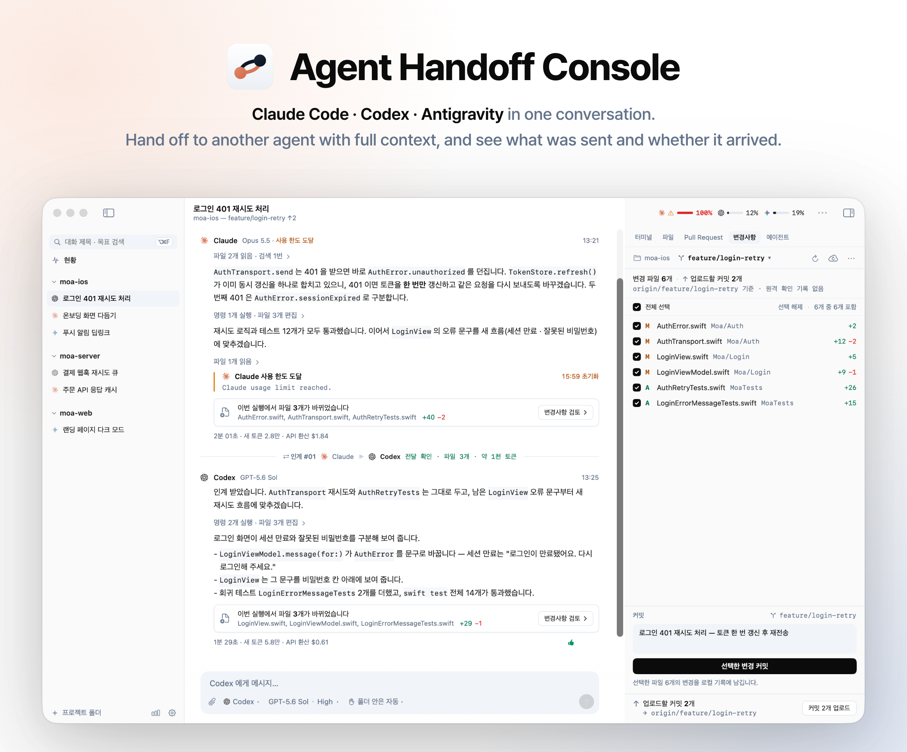
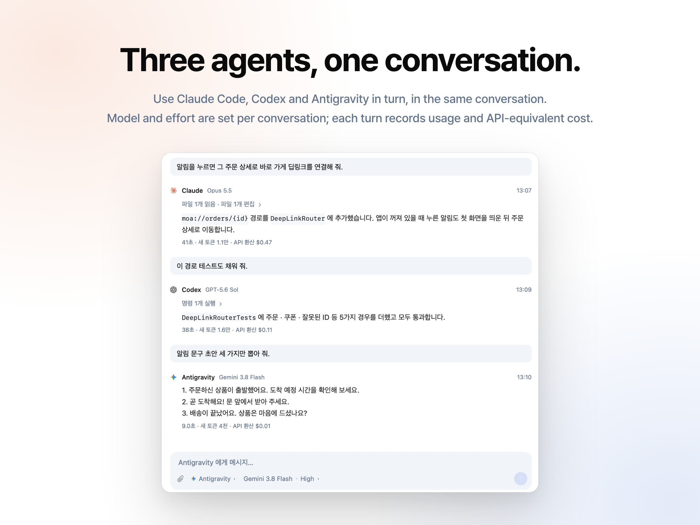
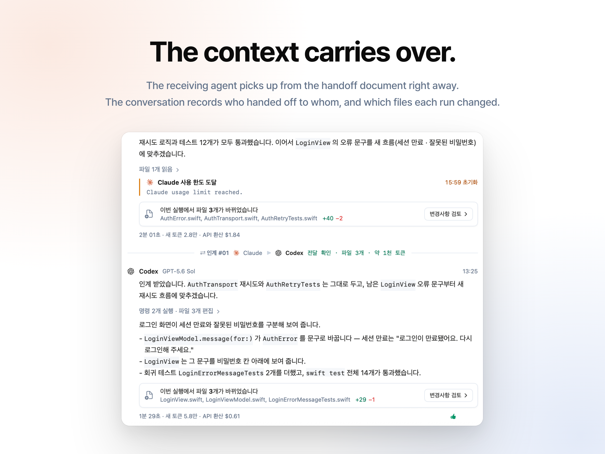
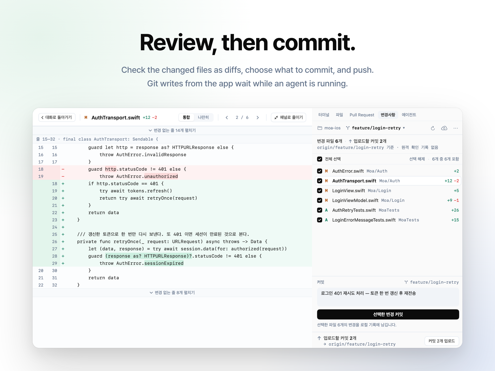

# Agent Handoff Console

**English** · [한국어](README.ko.md)

<!-- The images in docs/images/ are real app screenshots (the *-en.png versions carry English headlines). Regenerate them with: bash scripts/readme-images/make.sh -->
<picture>
  <source media="(prefers-color-scheme: dark)" srcset="docs/images/hero-dark-en.png">
  
</picture>

**A native macOS app that runs Claude Code, Codex and Antigravity side by side, and hands a conversation from one agent to another with its context, its file state, and a record of whether the handoff arrived.**

> [!NOTE]
> **The v0.1 user interface is in Korean.** An English UI is planned for v0.2. The screenshots show the Korean UI; this README gives Korean labels in parentheses where they help you find things. The complete manual is in Korean: [README.ko.md](README.ko.md).

Switching coding agents in the middle of a task usually means explaining the goal again and waiting while the new agent rediscovers the code. Agent Handoff Console keeps one conversation per task. When you want another agent to take over, because one is close to its usage limit or another suits the next step better, the app writes a handoff document from the conversation record and the actual state of your project folder. You see it as a card before anything is sent. The receiving agent starts from the document's "next action", and the conversation records who handed what to whom and whether it was delivered.

The app drives the official CLIs you have already installed and signed in to (`claude`, `codex` and, optionally, `agy`) through their structured protocols. There is no server and no account, and the app itself makes no network requests.

Agent Handoff Console is an independent personal project. It is not affiliated with Anthropic, OpenAI or Google.

## Features

### Hand off a conversation

- Open the agent chip in the composer (에이전트 칩) and choose another agent. A **handoff card** (인계 카드) appears at the end of the conversation. It shows:
  - the receiver: what the app has confirmed about its CLI, login and usage (and how long ago), whether it resumes an earlier session, and a picker for the receiving model and reasoning effort (picking one pauses an automatic countdown);
  - a summary of the document: next action, goal, file state, tests, items to verify;
  - a field for a note of your own, and a button to open and edit the full document.
- Nothing runs until you tick **I've reviewed this** (내용을 확인했습니다) and press **Hand off to …** (… 에게 넘기기). Inside the card, ⌘↵ ticks the box on the first press and sends on the second.
- The document is assembled by rules from what the app recorded: your instructions, changed files, commands and their exit codes, approval requests you denied (passed on as "don't do this again"), and commits made since the last handoff. A fresh git snapshot is added. Facts the app could not confirm are labelled as unconfirmed instead of being filled in. For example, if no test run was observed, the document says so and tells the receiver not to assume the tests pass. Secrets in excerpts are masked on a best-effort basis.
- Optionally, Gemini (through the Antigravity CLI) can tidy the document. The app checks its citations, next-action evidence and test exit codes before using the result, and keeps its own version if that fails.
- Messages you type while a card is open are held. They go to the receiving agent once the handoff is delivered.
- If the conversation moves on or files change after the card was drafted, the card refuses to send and offers to rebuild itself.
- Every handoff is tracked as delivered, failed (send again from the same card) or unknown. When delivery is unknown, the app never re-sends on its own.

### Automatic handoff and continue suggestions

- **Automatic handoff** is off by default (Settings › Handoff, 설정 › 인계). When it is on and a run stops at a usage limit, the app goes through your receiver priority list. It takes the first receiver whose CLI runs, whose login is confirmed and whose usage has room. It then checks that the previous agent's process has ended and that a next action was found, and counts down 5, 10 or 30 seconds on the card before handing off. You can send now, pause or cancel from the card, or cancel or review from the macOS notification. If anything is uncertain, nothing is sent: a review card explains why and what you can do.
- **Continue suggestions** come before a limit. When the current agent's 5-hour window passes 75% (or its weekly window passes 90%), a one-line bar above the composer offers to hand off to a receiver with room. It only prepares the card and never sends.

### Run several agents at once

- One run per conversation. Runs in different conversations proceed in parallel, even in the same folder. When two runs overlap in one folder, the app says so instead of guessing whose change is whose.
- **Split view**: show 1, 2 or 4 conversations side by side (⌃⌘1, ⌃⌘2, ⌃⌘4). Each pane header shows its status (running, waiting for approval, question, background tasks, handoff countdown, finished 3 minutes ago, …). A "needs response" chip in the toolbar collects every conversation waiting for you.
- **Overview** (현황, ⌃⌘0): every running agent and everything waiting for you on one screen, including conversations that aren't open in a pane. From there you can allow or deny ordinary approval requests, pick an answer to a simple question, stop a run, or pause an automatic handoff. Irreversible commands, commands that are multi-line, very long or contain hidden characters, permission requests and requests with input fields can only be approved in the conversation itself.
- The menu bar icon and the Dock badge show runs that need you. macOS notifications arrive when a run finishes or waits for you, unless you are already looking at that conversation. The menu bar's usage list can be trimmed to the accounts and windows you care about (Settings › General, 설정 › 일반, "메뉴바에 보일 한도"); the toolbar chip is not affected.

### Review, commit and isolate work

- **Changes tab** (변경사항): each run that changed files gets a card listing them, compared before and after the run. The tab has unified and side-by-side diffs with in-line highlights, a checkbox per file to stage it, commit, branch creation and switching, and fetch, pull and push; pull and push list the commits involved and ask first. Git writes wait while an agent is running in that folder. The app never force-pushes or runs `reset --hard` or `clean`, and it deletes no branch except, if you choose so, a conversation's own `ahc/` worktree branch when you clean that worktree up.
- **Per-conversation worktrees** (독립 작업 폴더), optional: a conversation can work in its own git worktree on branch `ahc/<id>`. From the Changes tab you merge it back, catch up with the project branch, or clean it up. Before a merge, the app stops without touching anything if the project folder is in the middle of a merge or rebase, or has uncommitted changes in files the merge would change.
- **Files** (with an in-app preview of Markdown, text, code and images), **Pull Request** (read-only, via `gh`) and **Terminal** tabs: the Terminal tab runs your own shell in a real terminal (SwiftTerm), next to a read-only log of the commands the agents ran. In the Files tab, a file that could run something (an app, a script, an executable, or a symbolic link or Finder alias pointing to one or to a folder) is shown in Finder instead of opened. ⌘-clicked links in the terminal open like links in messages: web addresses directly, files in Finder, other schemes after you confirm.

### Sub-agents and background work

- When Claude starts background agents, workflows or background shells, or Codex starts sub-agents, the run stays open until they finish. Claude's follow-up turn arrives in the same run. For Codex, the app adds the answers of sub-agents nobody waited for to the main thread, so the next turn knows them.
- Each sub-agent appears as a card where it was launched. The Agents tab (에이전트, ⌘⌥5) shows its stream, final answer and share of tokens. ⌘. stops everything that is left.

### And also

- **Approval and question cards**: commands, diffs, new files and input fields laid out for review, with a warning for irreversible commands (`rm -rf`, `git push --force`, `reset --hard`, piping a download into a shell, …). Commands break at every line-breaking character, and hidden or reordering characters show as markers such as ␍ or ⟨U+202E⟩; "명령 복사" (copy command) copies the original. A reason you give when denying goes back to Claude. Optional per-conversation auto-approve, which new conversations can start with (Settings › Agents, off by default).
- **Models and reasoning effort** per conversation, from the lists your installed CLIs report. New conversations start with the model you last used in that project.
- **Claude on API credits**: if you add a Claude Console API key (stored in the macOS Keychain), a per-conversation switch runs Claude with that key, for example to use the API credits that come with some Claude plans. When the subscription limit is reached, **Continue on API credits** (API 크레딧으로 계속) resumes the same Claude session. This is not a handoff.
- **Switch Codex accounts without a handoff**: register several Codex accounts (each is its own `CODEX_HOME` folder) and pick another one in the agent chip. The conversation keeps its Codex session: from the next message, that session continues under the other account's sign-in and usage limits. At a usage limit, **Continue on …** (… 에서 이어 가기) switches the account and asks the same session to carry on; with automatic handoff on, a countdown does the same. If the other account cannot resume the session, the run fails instead of quietly starting a new one.
- **Per-turn footer**: time taken, new tokens, and the cost at public API prices. This is an estimate, not your bill.
- The composer's `/` list shows the commands and skills your CLIs report. You can attach images, queue messages while a run is going, and search inside a conversation (⌘F).
- **First-run checklist** (Help › 시작 점검…): which CLIs are installed and signed in, notifications, Git, and your first project folder.
- **Import** your existing Claude Code and Codex sessions (File › Claude Code · Codex 기록 가져오기…) and continue them here.
- **Agent records** (에이전트 기록, ⇧⌘B): your own tally on this Mac of runs, ratings and handoffs per agent.
- **Experimental, off by default**: automatic task orchestration, which splits a goal into tasks, assigns them, runs them one at a time and verifies each. Turn it on under Settings › Advanced › Experimental features (설정 › 고급 › 실험 기능).

### Supported agents

| Agent | CLI | How the app talks to it | Approvals in the app |
|---|---|---|---|
| Claude Code | `claude` | `claude -p` with `stream-json` input and output | Yes: tool requests become approval cards (`--permission-prompt-tool stdio`) |
| Codex | `codex` | `codex app-server --stdio` (JSON-RPC) | Yes: commands, file changes, permission requests, MCP input requests, questions |
| Antigravity | `agy` (optional) | `agy` with `stream-json` | **No.** The CLI cannot ask for permission headlessly, so it runs with `--dangerously-skip-permissions`. Off by default; allowed per project |

## Screenshots

The screenshots show the Korean UI of v0.1.



*Three agents in one conversation. Model and reasoning effort are set per conversation, and each turn records its usage.*


*The handoff card. You review the document, add a note if you like, and send.*



*After the handoff, the receiving agent continues from the document. The conversation records the handoff and the files each run changed.*



*Review the diffs, choose files, commit and push. Git writes wait while an agent is running in that folder.*

## Requirements

- **macOS 15 Sequoia or later.** Developed and tested on Apple silicon with macOS 26. Intel Macs are untested.
- **At least one agent CLI, installed and signed in:**
  - Claude Code (`claude`), signed in with `claude auth login`.
  - Codex CLI (`codex`), signed in with `codex login`. Each extra Codex account is its own `CODEX_HOME` folder.
  - Antigravity CLI (`agy`): optional. It can be used as an agent in projects you allow, and to tidy handoff documents.
- **Git**, from the Xcode Command Line Tools (`xcode-select --install`), for the Changes tab, worktrees and handoff snapshots.
- **GitHub CLI** (`gh`): optional, for the pull request row in the Changes tab and the Pull Request tab.
- **To build from source:** Xcode 26. The code uses macOS 26 SDK APIs behind availability checks.

The app does not install anything or sign in for you. The first-run checklist links to each tool's official instructions and copies the commands. Everything the agents do counts against your own plans: runs started by this app, including `claude -p`, use your Claude subscription's usage limits under Anthropic's current policy, which may change.

## Install

### Download a release

1. Download the `.zip` from the latest release on the [Releases page](https://github.com/jinuklee777/agent-handoff-console/releases) and check it against the SHA-256 checksum published with the release:

   ```bash
   shasum -a 256 ~/Downloads/AgentHandoffConsole-*.zip
   ```

2. Unzip it and move `AgentHandoffConsole.app` to `/Applications` (or `~/Applications`).
3. The app is not signed with an Apple Developer ID or notarized (it is ad-hoc signed), so macOS blocks it the first time:
   - Open the app. When macOS says it can't verify the app is free of malware, click **Done**.
   - Open **System Settings › Privacy & Security**, scroll to **Security**, click **Open Anyway** next to the app, and confirm with your password or Touch ID.
   - On macOS 15 and later, Control-click › Open no longer skips this check.
   - If you trust the download, you can instead remove the quarantine attribute in Terminal. This also helps if macOS reports the app as "damaged":

     ```bash
     xattr -dr com.apple.quarantine /Applications/AgentHandoffConsole.app
     ```

There is no automatic update. To update, download the new release and replace the app.

### Build from source

You need Xcode 26.

```bash
git clone https://github.com/jinuklee777/agent-handoff-console.git
cd agent-handoff-console
xcodebuild -project AgentHandoffConsole.xcodeproj -scheme AgentHandoffConsole \
  -configuration Release -derivedDataPath build/DerivedData.noindex build
open build/DerivedData.noindex/Build/Products/Release/AgentHandoffConsole.app
```

- On the first build, Swift Package Manager fetches SwiftTerm 1.10.0, the only external dependency.
- Keep `-derivedDataPath build/DerivedData.noindex`. Copies left in Xcode's default DerivedData folder show up in Spotlight as duplicate apps; a `.noindex` folder is not indexed.
- Apps you build yourself are not quarantined, so Gatekeeper does not block them.
- If `xcodebuild` complains that the Command Line Tools are selected, run `sudo xcode-select -s /Applications/Xcode.app`.

Alternatively, `./scripts/install-app.sh` builds a Release, installs it as `~/Applications/AgentHandoffConsole.app` and opens it. If the app is running, it first asks it to quit as ⌘Q would, and it unregisters other built copies of the app from Launch Services without deleting them. Its messages are in Korean; run it with `--help` for the options.

### First launch

With no projects yet, the window shows the first-run checklist (시작 점검): the agent CLIs and their sign-in state, notifications, and Git. Choose a project folder (File › 프로젝트 폴더 열기…, ⌘O). The first conversation opens with an agent that is ready, and you type your request and press ↵. The checklist only advises; it never stops you from opening a folder. You can reopen it later from Help › 시작 점검….

## How it works

- **Structured protocols instead of terminal scraping.** Each turn starts one CLI process: Claude Code in `stream-json` mode, Codex as `app-server` (JSON-RPC), Antigravity in `stream-json` mode. Sessions resume with `--resume`, `thread/resume` or `--conversation`. Each adapter converts its CLI's events into one internal event type, so protocol changes stay inside the adapter. Approval requests travel both ways, so you answer them in the app.
- **The process ends with the turn.** That lets the app confirm the previous agent has stopped working on your files before it hands off. If the agent left background work running, the run waits for it (see "Sub-agents and background work").
- **Everything is stored locally in SQLite**: projects, conversations, each conversation's CLI session per agent (one Codex session per conversation, whichever of your Codex accounts runs it), runs, events, handoffs and usage.
- **The handoff document** has these sections: next action, goal, must keep, in progress, completed, key decisions, current file state, tests, failures and interruptions, needs verification, and an excerpt of the earlier conversation that is marked as reference material, not new instructions. A short preface tells the receiving agent that the app sent the document. The document follows the UI language, so in v0.1 it is written in Korean.
- **Honesty rules.** What the app cannot determine is shown as unconfirmed. A usage limit it cannot parse shows "no information", not 0%. Costs are public-API-price equivalents, not your bill, and a model without a known price shows "price unknown", not $0. Cancelling a run doesn't count as a model failure. Usage of an interrupted run is marked as not final. After a restart, earlier runs are not marked complete. A handoff whose delivery is uncertain is never sent again automatically.
- **Tests.** `scripts/build-inttest.sh` compiles the app's non-UI sources into a test harness. `inttest offline` runs thousands of checks without calling any CLI, including replays of recorded real Claude Code and Codex sessions (`scripts/probe/*/logs`).

## Privacy: what runs on your Mac and what leaves it

- **No server, no account, no telemetry.** The app itself makes no network requests. Only the CLIs it starts (`claude`, `codex`, `agy`, `git`, `gh`) use the network, each under its own settings and terms.
- **Messages to an agent** go from that agent's CLI to its provider. Besides your conversations, the app starts CLIs to check things:
  - At launch and in the first-run checklist: `--version`, `claude auth status --json`, and the files in each Codex account folder.
  - Usage limits: Codex is asked through `codex app-server`, including `account/read` for the account's email and plan. For Claude, the app runs `claude -p /usage`, which starts a full Claude Code session in which your hooks and MCP servers run. It does so at launch, after a Claude run finishes (at most once a minute), before an automatic handoff, and when you refresh the limits. Turning off "앱을 열 때 사용 한도 확인" under Settings › Agents › Claude Code (설정 › 에이전트 › Claude Code) skips only the check at launch (and when you open your first project or Claude's sign-in is newly confirmed) and the refreshes that continue suggestions and a conversation's usage-limit notice would start on their own. The checks after a Claude run and before an automatic handoff still happen. For Antigravity, the app runs `agy -p /usage` (no model call), only if a project allows Antigravity.
  - Model lists: Codex `model/list` at every launch; Claude `claude -p /model` only when the saved list is older than a day or the CLI version changed. Until you open your first project, the app holds back both Claude checks. `agy models` runs only if a project allows Antigravity or you chose to tidy handoff documents with Gemini.
  - The composer's `/` list asks the CLI for its commands and skills. Claude gets only an `initialize` request, with no model call; Codex gets `skills/list`.
  - Conversation titles: after a conversation's first successful run, the app sends the beginning of the first message and answer, with secrets masked on a best-effort basis, to a small model from the same provider (`claude -p --model haiku`, or `codex exec`) to get a short title. These calls are not saved in the CLIs' session history. Turn this off under Settings › General (설정 › 일반), "대화 제목 자동 요약".
- **Handoff documents** go to the receiving agent's provider through its CLI. They contain changed files, commands and conversation excerpts, with secrets masked on a best-effort basis. With automatic handoff on, they are sent without your review.
- **Tidying with Gemini** (off by default) sends masked handoff material (conversation, tool output, a limited git diff) to Google through `agy`. You can turn it off per project.
- **git and gh.** The app's own `git` commands contact your remotes only when you fetch, pull or push in the Changes tab. When you open the Changes tab or the Pull Request tab, `gh` asks GitHub about the current branch's pull request (`gh pr view`, `gh pr list`), once per project and branch, if `gh` is installed (the Changes tab asks only when the repository has a remote). It doesn't poll; "PR 다시 조회" in the Changes tab's ··· menu or the Pull Request tab's refresh button asks again.
- **Shell environment.** Apps opened from Finder don't inherit your shell setup, so the app asks your login shell once for `PATH` and CLI-related variables (proxies, `CODEX_*`, `CLAUDE_CODE_*`, …) and passes only those to the CLIs. The values are kept in memory only. API keys and authentication tokens from your shell (`ANTHROPIC_API_KEY`, `ANTHROPIC_AUTH_TOKEN`, `CLAUDE_CODE_OAUTH_TOKEN`, `OPENAI_API_KEY`, `CODEX_API_KEY`, `CODEX_ACCESS_TOKEN`, `GEMINI_API_KEY`, `GOOGLE_API_KEY`, `GOOGLE_CLOUD_API_KEY`) are passed on only if you enable it under Settings › Agents. Passing an Anthropic API key can make `claude -p` bill that key instead of your subscription.
- **Claude session files.** When a conversation moves into or out of its own worktree, the app copies that conversation's Claude session file inside `~/.claude/projects/` (or `$CLAUDE_CONFIG_DIR`), because `claude --resume` only looks in the folder the session belongs to.
- **Codex account folders.** To continue a conversation's Codex session under another account, the app builds a temporary `CODEX_HOME` for that run out of symbolic links: the running account's files (`auth.json`, `config.toml`, skills, …) and the session records in the folder that holds the session. Nothing is copied, so token refreshes are written to the account's own `auth.json`. The temporary folder is deleted when the run ends. The app may create a missing, empty session-record folder or file in the folder that holds the session; it changes no existing file there.
- **Codex client name.** The app identifies itself to `codex app-server` as `AgentHandoffConsole` (`clientInfo`); what Codex does with that name is up to Codex.
- **Where data lives.** Conversations are stored in `~/Library/Application Support/AgentHandoffConsole/handoff.sqlite3` and attached images in `attachments/` next to it; an image file is deleted when the last conversation that uses it is deleted, or when you remove it from the composer before sending. Worktrees are created in `~/.agent-handoff-console/worktrees/` (configurable). A Claude API key, if you add one, is kept in the macOS Keychain and passed only to the `claude` processes of conversations you switch to API credits.
- **No sandbox.** The app needs to run CLIs in any folder you choose, so it is not sandboxed. macOS permission prompts triggered by the CLIs (folder access, Photos, …) appear under this app's name.

## Accounts, terms and trademarks

- The app runs the official CLIs as you installed and signed in to them. It never signs in for you and never copies or sends the CLIs' own login credentials. For Codex it only reads `auth.json` to see whether it holds credentials, without decoding the tokens; the temporary `CODEX_HOME` used to continue a session under another account links to that file instead of copying it. The only credential the app stores is the optional Claude API key described above. API keys and tokens from your shell are passed to the CLIs only if you turn that on (see "Shell environment" above).
- Use only your own accounts. If you register several Codex accounts, they must all be yours, and each plan's terms apply. With automatic handoff on, a conversation that hits a limit can continue on another of your Codex accounts (the same Codex session, not a handoff).
- Antigravity edits files and runs commands **without approval prompts**. That is why it is off by default and must be allowed per project.
- Claude and Claude Code are trademarks of Anthropic; OpenAI and Codex of OpenAI; Google, Gemini and Antigravity of Google. The agent logos the app draws belong to their owners and are not covered by this project's MIT license.

## Known limitations

- The UI is Korean only in v0.1; English is planned for v0.2. Handoff documents are in Korean too, because they follow the UI language.
- No Developer ID signature, notarization or auto-update.
- The app depends on the CLIs' structured output. Protocol notes were measured with Claude Code 2.1.266–2.1.292, Codex CLI 0.153–0.160 and Antigravity CLI 1.2.1–1.3.2 (see [docs/CLI프로토콜.md](docs/CLI프로토콜.md)). The live CLI tests for streaming, resume, approvals, interrupts, a Claude → Codex → Claude handoff and Antigravity also pass with Claude Code 2.1.295, Codex CLI 0.162.0 and Antigravity CLI 1.3.3 (2026-10-10). A CLI update can still break parsing.
- Handoff cards live in memory. Quitting discards drafts that weren't sent; the quit dialog warns you.
- Automatic handoff and continue suggestions were tested with simulated limits and fake adapters, not end to end against real usage limits. The suggestion thresholds (75% / 90%) are constants, not settings.
- A background command that never exits (a dev server, say) keeps its conversation and folder busy until you stop the run (⌘.). If an agent CLI crashes, rather than being stopped by the app, background commands it started can keep running; stop them in Activity Monitor.
- Antigravity has no approvals. Its usage limits are shown (read with `agy -p /usage`, per model group), but in v0.1 it is never chosen for automatic handoff or continue suggestions.
- MCP servers, hooks and computer-use features are not fully tested.
- A new Codex account folder does not inherit `config.toml`, skills, hooks or MCP settings from `~/.codex`. Copy or link them yourself, but never share one `auth.json` between folders.
- Continuing a Codex session under another account was tested with two real accounts (A → B → A, Codex CLI 0.162.0). An account that keeps its Codex login in the Keychain instead of `auth.json` cannot continue another account's session; the app says so and doesn't start the run. Three or more accounts, Team and Business accounts, and the countdown at a real usage limit have not been tested end to end.
- The Files and Pull Request tabs are read-only: no PR comments or merges.
- The changes list shows a submodule only when its checked-out commit changes; uncommitted edits inside a submodule are not listed. The app's own automatic Git reads skip filter and diff drivers that a repository defines in its own `.git/config` (global ones such as Git LFS still run, except when the repository's config adds a Git LFS extension, `lfs.extension.*`, which Git LFS would run; then the app's reads skip Git LFS too), so a file using such a filter can show as changed until Git refreshes its index, for example after `git status` in a terminal.
- Performance with three or more simultaneous runs, or four streaming panes, has not been measured.

## Documentation

- [README.ko.md](README.ko.md): the complete manual (Korean).
- [docs/코드구조.md](docs/코드구조.md): the code map, with each file's responsibilities, data flows and where to start for each kind of change (Korean). [AGENTS.md](AGENTS.md) and [CLAUDE.md](CLAUDE.md) point AI coding agents to it.
- [docs/CLI프로토콜.md](docs/CLI프로토콜.md): measured notes on the CLI protocols the adapters rely on (Korean).
- [CHANGELOG.md](CHANGELOG.md).

Developer documentation, code comments and commit messages are written in Korean. Issues and pull requests are welcome in English or Korean.

## Contributing

See [CONTRIBUTING.md](CONTRIBUTING.md) for building, running the tests and opening a pull request. Report security issues privately as described in [SECURITY.md](SECURITY.md), not in public issues.

## License

[MIT](LICENSE) © 2026 jinuklee777. Third-party code bundled with the app and its licenses are listed in [THIRD_PARTY_NOTICES.md](THIRD_PARTY_NOTICES.md).
